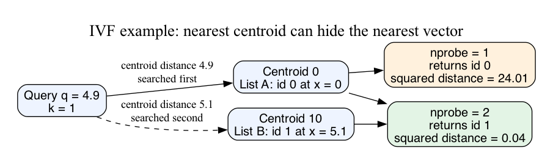

# What this lesson is trying to teach

Approximate nearest-neighbor search reduces work by restricting the vectors it
examines. Choose that restriction against a measured recall requirement.

## If you remember only these things

- Define distance, eligibility, and tie handling before measuring accuracy.
- Exact candidate scoring still permits missed neighbors outside the candidate set.
- Search effort, index construction, and compression have separate costs and errors.
- Compare latency among configurations meeting the required recall.
- Test representative queries, filters, and changes to the indexed distribution.

## The problem and distance contract

A document service represents each document with a vector, an ordered list of
numbers. An embedding model produces those numbers. This lesson starts after
embedding and retrieves the nearest k documents to a query vector.

Exact search compares all eligible vectors. Squared Euclidean distance is
`sum((q[j] - x[j])**2)`. Distance work grows with population N and dimension d as
O(Nd). Selecting the smallest k adds work; this example uses a bounded heap.
Squared distance preserves Euclidean ordering and avoids a square root.
For nonzero unit vectors, maximum inner product and minimum squared Euclidean
distance have the same ordering. Cosine search requires explicit normalization
and zero-vector handling. See the [Faiss distance contract](https://github.com/facebookresearch/faiss/wiki/MetricType-and-distances).

The example accepts integers and orders ties by document ID. Python integer
arithmetic avoids rounding and overflow. SQLite ground-truth arithmetic stays
within signed 64-bit bounds for these declared small-coordinate fixtures.

## IVF mechanics and the running example

An inverted-file index (IVF) assigns each vector to its closest centroid, a
representative vector. Each centroid owns a list of document IDs. Common
production implementations learn centroids from representative training data.
The teaching model accepts fixed centroids to isolate candidate selection.

A query chooses the closest nprobe centroids from nlist total centroids. It then
scores their entries. IVF-Flat retains original vectors and computes exact
candidate distances. Its approximation comes from the omitted lists.
[Faiss IVF documentation](https://faiss.ai/cpp_api/struct/structfaiss_1_1IndexIVF.html)
describes assignment and multi-probe search.

Consider documents ID 0 at 0 and ID 1 at 5.1, assigned to centroids 0 and 10.
Query 4.9 is closer to centroid 0, while its closest document is ID 1.



One probe returns ID 0 at squared distance 24.01. Two probes find ID 1 at
squared distance 0.04. Reranking only the first list cannot recover ID 1.
The runnable demo multiplies coordinates by ten, producing integer squared
distances 2401 and 4. Run from this directory with Python 3.9 or later:

```bash
python3 ann.py demo
python3 experiment.py check
python3 experiment.py bench > results.json
```

Expected demo output:

```text
1 0 2401
2 1 4
```

The core selection code is:

```python
chosen = sorted(range(len(centroids)),
                key=lambda c: ((query - centroids[c]) ** 2, c))[:probes]
candidates = [i for c in chosen for i in lists[c]]
best = min(candidates, key=lambda i: ((query - points[i]) ** 2, i))
```

`ann.py` contains the complete dimension-independent implementation, including
construction, input validation, empty populations, and top-k selection.
`experiment.py check` uses an independent SQLite expression to rank all vectors
and selected candidates. It checks full-probe equality, assignment, unique list
membership, nested-probe recall, ties, empty populations and lists, invalid
inputs, and the explicit one-probe counterexample. Expected: 5760 comparisons,
seven rejected invalid inputs, and the counterexample detected.

## Alternatives and selection

| Method | Main work and cost | When to test it |
|---|---|---|
| Exact scan | All eligible vectors; distance work O(Nd) | A competitive baseline, small eligible sets, weak build amortization, exhaustive requirements |
| IVF-Flat | Centroid selection and list scans; missed partitions and list skew | Representative partitions reduce actual candidate counts |
| IVF with product quantization | Compact code scoring; training and representation error | Vector memory or bandwidth limits the workload |
| HNSW | Layered graph traversal; graph storage and build cost | Memory permits graph state and low query latency matters |

Product quantization splits coordinates into groups and encodes each with a
learned codeword. Increasing code size trades space for representation capacity.
Raw-vector reranking requires retaining originals and retrieving useful candidates.
See the [Faiss index catalog](https://github.com/facebookresearch/faiss/wiki/Faiss-indexes).

HNSW means hierarchical navigable small world. Upper graph layers guide traversal;
the base layer searches a broader candidate set. Edge capacity and construction
effort affect graph quality and memory. Query breadth changes recall and work.
The [original HNSW paper](https://arxiv.org/abs/1603.09320) describes its hierarchy
and neighbor selection. Production behavior depends on data and implementation.

## Costs, failure modes, and acceptance

For balanced IVF lists, p probes over L lists scan about N*p/L vectors plus
centroid scoring and top-k selection. Measure actual occupancy and candidates.
Training, assignment, peak memory, rebuilds, and query work need separate budgets.
At full probing, this model scans every ID and equals exact search; it also pays
centroid-selection and candidate-list costs.

A filter changes eligible ground truth. Global top-k followed by filtering can
underfill and omit eligible neighbors. Compare with exact search over the filtered
population at the same snapshot. Exact search over a small eligible set can win.
Production filters, updates, deletion visibility, and snapshot coordination require
additional tests beyond this immutable, unfiltered model.

Distribution changes can increase list imbalance or put queries in poorly
represented regions. Compression adds representation error; traversal adds
candidate omissions. Reranking only repairs ordering within its candidate pool.
Recall measures ID agreement with the chosen distance contract. Application
relevance requires its own labeled data and acceptance criteria.

For E eligible documents, let r=min(k,E). Recall is the distinct valid result-ID
overlap with exact top-r, divided by r. Empty-set recall is undefined; require an
empty result. Valid fill divides by k and differs from recall when E<k.
All timed workloads have E>=k=5. Nested probe sets make recall nondecreasing in
this model because all candidates use identical exact scores and a stable tie rule.
General graph search controls need their own implementation-specific analysis.

## Experiment protocol

The methods are exact, IVF1, IVF4, and IVF16. All share integer squared distance,
ID tie order, a heap-based top-k implementation, and the same corpus/query bytes.
Sixteen fixed centroids are the Cartesian product {0,100}^4. A seed-102 generator
selects a centroid uniformly, then adds independent integer coordinate noise.
The corpora and queries are independently drawn from that fixed distribution.

| Workload | Vectors | Dimension | Queries | Coordinate noise |
|---|---:|---:|---:|---|
| tiny | 64 | 4 | 32 | uniform integer [-8,8] |
| separated | 2048 | 4 | 32 | uniform integer [-8,8] |
| overlap | 2048 | 4 | 32 | uniform integer [-70,70] |

Each method/workload has six fresh-process samples. Three blocks rotate the method
order and execute it followed by its reverse. Each worker warms all 32 queries
once, then times one complete batch with `perf_counter_ns`. Per-query times are
batch averages, so the ranges measure run variability rather than request tails.
Input generation, process startup, index construction, and oracle checks are
outside query timing. Query validation, candidate materialization, scoring,
selection, and result allocation are included. Index construction is timed
separately; exact scan can serve the original array without this IVF build.

Linux workers pin to the lowest allowed CPU. Local macOS affinity is uncontrolled.
Host load, clocks, thermals, SMT, and virtualization placement are uncontrolled.
Retain Python version, OS, CPU metadata, source hashes, all raw samples, list sizes,
recall, candidate counts, and construction times. Cross-host timings include
interpreter and environment differences.

Predeclared selection rule: mean recall >=0.95 over these 32 queries qualifies a
configuration. Name a latency winner only if its corresponding sample is at least
5% faster than every other qualifying method in all six rounds. Otherwise report
unresolved. This finite-query target supports this experiment only. Production
acceptance needs held-out query strata, quality uncertainty, loaded latency,
training/build variability, memory, and service costs.

Results and source identity are retained in RESULTS.md. The implementation is a
small Python teaching model; library, GPU, learned-centroid, quantized, graph,
mutable, filtered, and service-tail results require separate experiments.
