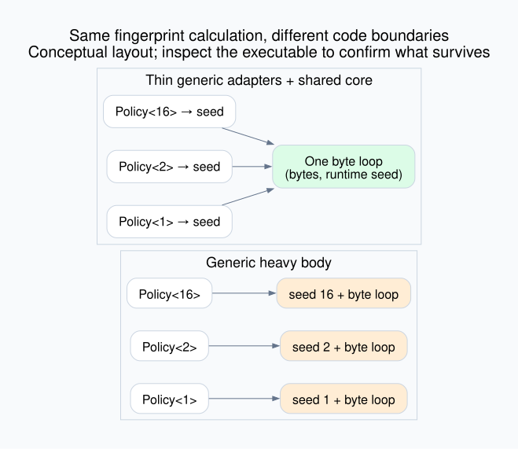

# Rust monomorphization and code-size amplification

Sixteen policy types change only a fingerprint's initial seed. Compare a generic
byte loop with a thin generic adapter that passes the seed into a concrete loop.
Both implement the same wrapping-u64 contract. This fingerprint is educational;
it supplies no cryptographic guarantee.

```sh
cargo test -p monomorphization
cargo clippy -p monomorphization --all-targets -- -D warnings
python3 topics/080-monomorphization/scripts/campaign.py /tmp/mono-results
```

The output directory must be new. The campaign uses installed Rust 1.93.1 and
standard Python. On Linux it also uses GNU size, nm, objdump and CPU affinity.
Its four standalone executables are compiled directly from the same library and
example used by Cargo. Run `<output>/generic-16 8 0` to print oracle values, or
`<output>/outlined-16 4096 10000` for a timed run with a checksum.

Expected correctness output: four unit tests pass, one Cargo doctest passes,
and the campaign reports 442 independently checked policy/input values.
Every timed process's final checksum is also checked by the Python oracle.



## Contract and alternatives

`generic<P>` begins at `P::SEED` and performs XOR, wrapping multiply, and rotate
for every byte. `outlined<P>` extracts that seed and invokes `shared_core`.
The expensive operation no longer carries a type parameter. Empty input returns
the seed. The independent oracle uses Python integers, modulo arithmetic, and
quotient/remainder rotation; implementation agreement alone is insufficient.

A rough relevant-function model is `generic ≈ N*H`, `outlined ≈ H+N*W`, where
N is used policies, H the loop size, and W the adapter size. This excludes the
runtime, data, metadata and alignment. Optimization can merge, inline or clone
code, so inspect the final executable before asserting how many bodies survive.

Keep specialization when types expose useful constants or different operations.
Use a shared concrete core when type-specific work ends at normalization. A
concrete public API avoids wrappers but changes ergonomics. Trait objects allow
runtime-selected behavior; remaining indirect calls can matter in a hot loop.
An enum bounds the alternatives but can retain multiple specialized arms.
LTO and size-oriented profiles are separate interventions to compare under
fixed source and workload.

## Frozen experiment

- Four binaries: generic/outlined, each with 1/16 reachable policies.
- Workloads: one repeated 8-byte or 4096-byte input, evenly cycled policy indices.
- Identical opaque function-pointer selection in both arms. `black_box` guards
  inputs, function pointers and results. No allocations occur in the timed loop.
- Generic body, outlined adapters and concrete core use `inline(never)` hints.
  This holds call boundaries apart for inspection; it is not a production default.
- Rust 1.93.1, edition 2024, opt-level 3, codegen-units 1, LTO off, debuginfo 0,
  panic abort, explicit v0 mangling, default target CPU, no incremental build.
- Linux campaign and children pinned to the lowest permitted CPU. Hosts are
  shared; frequency, SMT neighbors, background load and page cache are uncontrolled.
- One warm compiler invocation per treatment, six fresh timed invocations in
  alternating order. These are warm-file-cache rustc+link measurements of this
  standalone program, not clean Cargo dependency builds or cold-machine times.
- One calibration process per runtime cell/arm. Its observed rate chooses an
  equal operation count for both arms, targeting 0.2 seconds in the faster pilot.
  Six paired, alternating-order measured processes follow. No samples discarded.
- A runtime winner requires all six paired ratios to exceed 1.05 in its favor.
  Otherwise report unresolved at 5%, not equivalence. Medians and full ranges
  are descriptive; no population confidence interval or universal verdict.

Inspect `*-nm.txt` for kernel families, `*-objdump.txt` for loop and adapter
calls, and `*-size.txt` for the exact `.text` section. File size and the default
GNU size text aggregate are different metrics. Compiler work, file bytes,
executable code size, and elapsed runtime answer separate questions.

See [sources](sources.md), [results](measurements/README.md), and [round](rounds/01.md).
