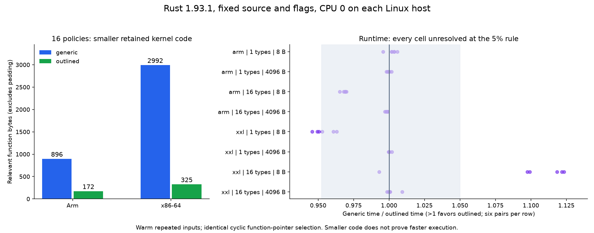

# Topic 080 measured results

Measured source: `c9e1c6e12a961a4869992a8fe0144bc5d8e96299`. Date: 2026-10-17.

Each host used Rust 1.93.1 (LLVM 21.1.8), pinned CPU 0, and the fixed flags in the [experiment](../README.md). Each runtime cell has six alternating-order paired processes. Each compiler cell has six fresh rustc+link invocations after one warm invocation. Shared-host load and clocks were uncontrolled. The local pilot is excluded.

Both hosts passed four unit tests, 442 independent oracle values, and the independently computed checksum in all 56 runtime processes (8 calibration, 48 measured). The measured source bytes matched the commit. Repeated builds produced one stable binary hash per host/treatment.

## Retained code and file size

| Host | Policies | Generic .text B | Outlined .text B | Generic file B | Outlined file B | Generic kernel B | Outlined adapters + core B |
|---|---:|---:|---:|---:|---:|---:|---:|
| arm | 1 | 233976 | 233976 | 4029504 | 4029600 | 56 | 60 |
| arm | 16 | 235704 | 234984 | 4031216 | 4031328 | 896 | 172 |
| xxl | 1 | 263344 | 263360 | 3903704 | 3903824 | 187 | 192 |
| xxl | 16 | 267552 | 264912 | 3909672 | 3907152 | 2992 | 325 |

With sixteen policies, disassembly shows 16 generic loops versus 16 small adapters tail-branching to one concrete loop. The outlined core uses a runtime seed. In the one-policy binary the optimizer specializes the helper for seed 1, despite its concrete signature and inline(never) hint. This is direct evidence that the source boundary alone does not fix code shape.

Outlining wins the sixteen-policy .text comparison on both hosts: 720 B smaller on Arm and 2640 B smaller on x86. The relevant function totals fall from 896 to 172 B and from 2992 to 325 B. These are symbol sizes excluding padding; their deltas need not equal the whole .text change. On Arm the outlined file is nevertheless 112 B larger. No section other than .text is attributed to a specific cause here.

## Runtime: nanoseconds per call

Median [minimum, maximum]. All cells are unresolved under the predeclared rule requiring every paired ratio to favor an arm by more than 5%. This is not proof of equivalence. No samples were removed.

| Host | Policies | Input bytes | Generic ns/call | Outlined ns/call | 5% verdict |
|---|---:|---:|---:|---:|---|
| arm | 1 | 8 | 7.228 [7.226, 7.248] | 7.209 [7.199, 7.259] | unresolved |
| arm | 1 | 4096 | 6302.537 [6301.837, 6312.657] | 6304.774 [6301.312, 6314.152] | unresolved |
| arm | 16 | 8 | 7.720 [7.684, 7.738] | 7.970 [7.957, 7.987] | unresolved |
| arm | 16 | 4096 | 6311.813 [6304.617, 6313.676] | 6319.562 [6318.008, 6329.619] | unresolved |
| xxl | 1 | 8 | 4.316 [4.300, 4.338] | 4.532 [4.496, 4.547] | unresolved |
| xxl | 1 | 4096 | 6378.686 [6376.198, 6391.728] | 6379.185 [6376.472, 6381.101] | unresolved |
| xxl | 16 | 8 | 4.828 [4.819, 4.840] | 4.354 [4.290, 4.859] | unresolved |
| xxl | 16 | 4096 | 6389.672 [6382.074, 6450.883] | 6391.508 [6385.103, 6393.555] | unresolved |

The x86 sixteen-policy 8-byte case has a favorable outlined median, but one pair reverses direction. Arm has a consistent roughly 3% short-input cost at sixteen policies, below the declared 5% threshold. The measurements establish elapsed work costs only; cache-miss causes, frontend pressure, cold-start behavior, energy, production type mixes and architecture-wide winners were not measured.

## Compiler invocation seconds

Median [minimum, maximum], including rustup selection, rustc and linking. Input and toolchain files were warm; each invocation rebuilt this standalone program. These descriptive samples do not estimate a cold build or dependency-heavy Cargo build.

| Host | Policies | Generic seconds | Outlined seconds |
|---|---:|---:|---:|
| arm | 1 | 0.240 [0.239, 0.241] | 0.240 [0.239, 0.241] |
| arm | 16 | 0.268 [0.266, 0.269] | 0.250 [0.248, 0.252] |
| xxl | 1 | 0.141 [0.139, 0.142] | 0.141 [0.139, 0.142] |
| xxl | 16 | 0.179 [0.177, 0.180] | 0.148 [0.146, 0.149] |

For sixteen policies, outlined median invocation time was about 6.9% lower on Arm and 17.4% lower on x86. No compiler phase timing or LLVM-IR count was collected; attribute this to the measured whole invocation, not a proven optimizer mechanism.

## Evidence and limits

Raw tables, exact flags, uname/lscpu/CPU identifiers, section sizes, kernel symbols, kernel disassembly and binary hashes are under `raw/`. Full disassembly and executables are retained in the daily evidence archive. The oracle checks 13 lengths for each reachable policy. Timed inputs repeat in cache and use cyclic function-pointer dispatch. The test is small and uses no LTO or production application context. Both required Linux hosts completed; no host replay is pending.

Arm host: `dev-dsk-ahrav-2b-7dc7bd93.us-west-2.amazon.com` (AArch64, CPU identifiers in raw evidence). xxl resolved to `dev-dsk-ahrav-2c-32182091.us-west-2.amazon.com`, verified x86_64, Intel Xeon Platinum 8488C. These are host results, not isolated ISA effects.
