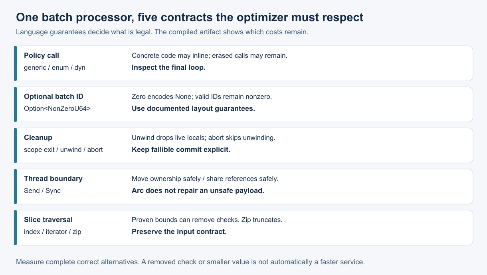

# What this lesson is trying to teach

Rust's language rules define the behavior a program must preserve. The optimizer decides how cheaply it can preserve that behavior. Keep those questions separate when choosing an abstraction.

Topic 81 uses one running example: a worker transforms integer batches, carries an optional batch ID, and releases resources when processing ends. Its result is a wrapping sum modulo 2^64. We want lower runtime cost while preserving its input, failure, and thread-safety contracts.

## If you remember only these things

- Dispatch once per batch when one policy applies to the whole batch. Retained per-item calls can prevent inlining and vectorization.
- Use documented layout guarantees. `Option<NonZeroU64>` can use zero for `None`; an arbitrary enum's observed layout is not a wire format.
- Unwinding runs cleanup; aborting does not unwind. A destructor cannot confirm a durable commit.
- `Send` permits ownership transfer; `Sync` permits shared references across threads. `Arc` does not repair an unsafe payload.
- Give the optimizer a bounds proof while preserving the input contract. `zip` alone silently truncates unequal inputs.



This visual was rendered and inspected on 2026-10-18.

## Dispatch: choose the boundary before counting calls

A generic function can specialize for its concrete policy type. A trait object such as `&dyn Policy` carries a data pointer and virtual method table. When the compiler cannot recover the target, its method call remains indirect. Recovering the target is called devirtualization. A `dyn` expression in source therefore does not prove an indirect call survives. [Trait objects](https://doc.rust-lang.org/reference/types/trait-object.html)

```rust
trait Policy {
    fn apply(&self, x: u64) -> u64;
    fn batch(&self, xs: &[u64]) -> u64 {
        xs.iter().fold(0, |s, &x| s.wrapping_add(self.apply(x)))
    }
}
fn generic<P: Policy>(p: &P, xs: &[u64]) -> u64 { p.batch(xs) }
fn per_item(p: &dyn Policy, xs: &[u64]) -> u64 {
    xs.iter().fold(0, |s, &x| s.wrapping_add(p.apply(x)))
}
```

Calling `p.batch(xs)` through `&dyn Policy` selects a concrete batch method once. Inside that method, the concrete `apply` may inline. In contrast, `per_item` may retain an indirect call for every element.

For n items, useful hypotheses are `T_item ≈ n × (work + call cost)` and `T_batch ≈ one call + n × optimized work`. These are explanatory models. Lost vectorization can dominate call latency. Inspect the final executable before attributing a timing difference to calls alone.

| Choice | Selection criterion | Cost or failure mode |
|---|---|---|
| Generic policy | A small set of hot concrete paths | Specialization can increase code size |
| Enum policy | A closed set of alternatives | Variant size and matching can add costs |
| Per-item trait object | Runtime behavior genuinely differs among items | Retained calls may block loop optimization |
| Per-batch trait object | One policy processes a whole batch | Requires an appropriate batch interface |

The experiment fixes one policy for each batch. It does not evaluate mixed objects, policy construction, allocation, plugin loading, or production request latency.

## Niches: invalid values can carry a tag

A niche is a representation that is invalid for a payload type and can represent another enum variant. Zero is invalid for `NonZeroU64`, so `Option<NonZeroU64>` can encode `None` there. Rust documents the same size and alignment as the payload. The example checks eight bytes. [Option representation](https://doc.rust-lang.org/std/option/index.html#representation)

This representation suits IDs whose domain excludes zero. If zero is a valid ID, introducing `NonZeroU64` changes the API. Never create an invalid payload value and expect an enclosing enum to make it valid.

A smaller field does not imply the same saving for its containing struct: alignment and padding matter. Measure the whole hot record. Encode protocol fields explicitly rather than serializing the bytes of default Rust layout. `repr(C)` establishes C layout rules but does not by itself define a portable wire format. [Type layout](https://doc.rust-lang.org/reference/type-layout.html)

## Drop and panic: decide what completion means

During unwinding, initialized live local variables drop as their scopes exit. Locals drop in reverse declaration order. Struct fields drop in declaration order after the type's own `Drop` method. [Destructors](https://doc.rust-lang.org/reference/destructors.html)

Use a guard for process-local resource release on early returns and unwinding. Put fallible completion in an explicit `finish` or `close` operation returning `Result`. Cleanup should be bounded and non-panicking. It cannot serve as durable commit confirmation or crash recovery.

With `panic=abort`, the process terminates without unwinding. A destructor panic during unwinding can also abort the process. The retained subprocess probe builds both panic strategies and checks observable markers without crashing the parent runner. [Panic behavior](https://doc.rust-lang.org/reference/panic.html)

`catch_unwind` catches unwinding panics; it neither catches abort nor restores a partly changed application invariant. The example's `AssertUnwindSafe` is justified only for its narrow logging closure, whose postcondition is checked. Dropping a caught panic payload can itself panic. [catch_unwind](https://doc.rust-lang.org/std/panic/fn.catch_unwind.html)

## Send and Sync: ownership transfer versus sharing

`Send` permits moving a value to another thread. `Sync` permits sharing references across threads; `T: Sync` means `&T: Send`. These are safety obligations, usually derived automatically from fields.

For immutable worker input, `Arc<Vec<u64>>` is suitable. `Arc<RefCell<Vec<u64>>>` is not safe concurrent mutation: atomic reference counting does not synchronize `RefCell`'s borrow state. Use ownership transfer, a suitable lock, or a justified atomic design. A manual unsafe implementation must justify every exposed safe operation, including aliasing, lifetime, and destruction. [Send and Sync](https://doc.rust-lang.org/nomicon/send-and-sync.html)

Two compile-fail doctests check that `Rc<u64>` and `Arc<RefCell<u64>>` do not satisfy `Send`. Positive checks cover `Arc<Vec<u64>>` and `Arc<Mutex<RefCell<u64>>>`. Tests illustrate these concrete types; they cannot prove an arbitrary unsafe implementation sound.

## Bounds: preserve the contract while exposing the proof

Our paired-input operation requires equal lengths and wrapping arithmetic:

```rust
fn dot_zip(a: &[u64], b: &[u64]) -> u64 {
    assert_eq!(a.len(), b.len());
    a.iter().zip(b).fold(0u64, |s, (&x, &y)| {
        s.wrapping_add(x.wrapping_mul(y))
    })
}
```

An indexed version with the same assertion can optimize equally well. The assertion and loop range expose a bounds proof. The resulting machine code determines which checks remain.

`zip` alone stops at the shorter slice. For a mutating loop, moving an assertion ahead of the loop can also change partial-update behavior when invalid input arrives. Preserve that behavior or explicitly change the contract and test it. `get_unchecked` requires a valid index even if the returned reference is never used. Prefer a safe restructuring before taking on this proof. [Slices](https://doc.rust-lang.org/std/primitive.slice.html)

## Runnable example

The adjacent `topic81-demo.rs` is a complete dependency-free program. From the output directory:

```sh
rustc --edition=2024 -C opt-level=3 -C panic=unwind topic81-demo.rs -o topic81-demo
./topic81-demo
```

Expected stdout:

```text
optional nonzero ID: 8 bytes
unwind cleanup: ["second", "first"]
dispatch=27 dot=14 thread_sum=6
```

The default panic hook also prints the intentional panic to stderr before it is caught. Compiling this demonstration with abort changes its behavior: it terminates before the final assertions and output. The experiment tests that behavior in an isolated child.

## Experiment and interpretation

The retained source package compares generic, enum, per-item dynamic, and per-batch dynamic dispatch for addition and multiply/rotate/xor policies. Batch sizes are 32 and 8192 u64 values. A separate indexed-versus-zip dot-product comparison uses the same equal-length contract.

Commands from the Systems repository root:

```sh
cargo test -p topic081-rust-runtime
cargo clippy -p topic081-rust-runtime --all-targets -- -D warnings
python3 topics/081-rust-runtime-semantics/experiment/run.py /tmp/topic81-run --cpu 0
```

The Python runner requires installed Rust 1.93.1 and Linux for affinity/objdump. It checks 390 independent oracle cases, six Rust tests, two compile-fail tests, and unwind/abort subprocess behavior. Every timed checksum is checked outside the timed region. It saves compiler commands, binary and source hashes, host identity, linked assembly, calibration, and all process timings.

Controls: opt-level 3, native CPU target, one codegen unit, LTO off, panic unwind, fixed runtime parameters, preallocated warm input, one pinned CPU, and six balanced process repetitions. Calibration chooses common repetitions per cell to target at least 30 ms for the fastest candidate, subject to a documented cap. There is one warmup per candidate per cell. Calibration and warmups are excluded from reported timings. `black_box` reduces unwanted optimization but is best effort; inspect the final code. [black_box](https://doc.rust-lang.org/std/hint/fn.black_box.html)

The ranking rule is descriptive: call A faster than B only if all six paired B/A ratios exceed 1.05. Call a practical tie only when all six ratios lie in [1/1.05, 1.05]; otherwise mark unresolved. Six observations do not establish population equivalence or a production guarantee. Report median, minimum, maximum, and pairwise outcomes for each host/workload. No universal winner follows from this experiment.

See the accompanying results for completed measurements. Those results distinguish observations from explanations and do not turn unavailable measurements into estimates.
