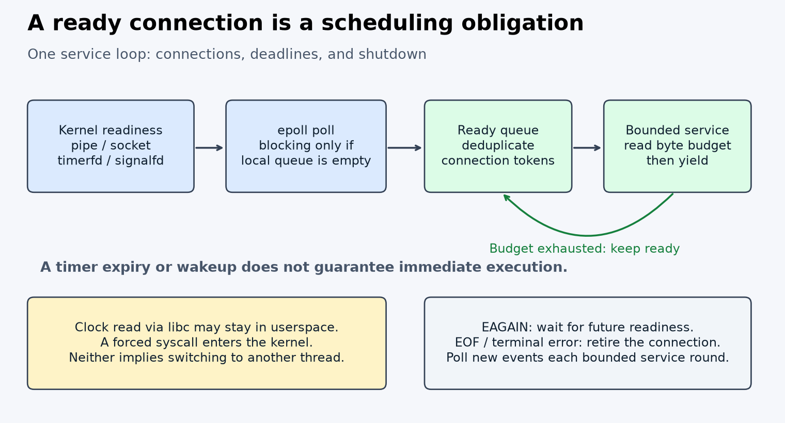

# Topic 082: Linux runtime internals

The Rust model retains a scheduling obligation after a byte-budget yield. It uses
fixed tokens and one owner. It is not a socket runtime. The Linux probes connect
this model to real pipe readiness, oneshot rearming, EOF, signalfd, timerfd, and
clock-call paths. See [sources](SOURCES.md) and [results](measurements/RESULTS.md).



## Run

From the repository root:

```sh
cargo test --locked -p topic082-linux-runtime
cargo build --locked --release -p topic082-linux-runtime --example oracle_cases
python3 topics/082-linux-runtime/experiment/oracle.py target/release/examples/oracle_cases
# Linux only; requires cc, Python 3 and taskset; strace is optional. No root or host changes.
python3 topics/082-linux-runtime/experiment/run.py /tmp/topic082-results 0
```

Choose an allowed CPU instead of 0 if needed. The runner records the actual CPU,
host, kernel, compiler, libc, source hashes, logs and individual process results.
The workspace pins Rust 1.93.1. C uses the host cc with
`-O3 -std=c11 -Wall -Wextra -Werror`; assertions remain enabled.

## Contracts

- Six Rust unit tests and one doctest check queue invariants. A separate Python
  oracle constructs schedules by sorting `(round, token)` pairs, without a queue.
  It checks all 864 emitted backlog/budget combinations, including EAGAIN visits.
- Linux tests check LT versus ET after a partial drain, oneshot rearming, bytes
  before EOF, a hot/cold/late pipe schedule, standard-signal coalescing, and one
  absolute monotonic timerfd expiry. They have bounded waits and no latency SLA.
- Two thousand clock brackets check `forced_before <= libc <= forced_after` for
  the same clock ID. CPU-time readings cannot substitute for elapsed deadlines.
- Timer wheels group deadlines into buckets; heaps keep them ordered. Neither
  structure guarantees when a callback gets scheduled. Linux epoll timeouts use
  hrtimer ranges; the kernel timer wheel is a separate mechanism.
- Affinity constrains placement. It does not remove interrupts, other runnable
  tasks, kernel work, SMT interference or shared-cache traffic.

## Experiment declared before measurement

Compare libc and forced `SYS_clock_gettime` for `CLOCK_MONOTONIC` and
`CLOCK_PROCESS_CPUTIME_ID`. Each host runs one million calls per process, one
warmup per treatment, then six pairs with alternating AB/BA order. Pin all timed
processes to CPU 0; run serially on each host. Compare only within a clock/host.
Record median and min/max nanoseconds per call and each paired syscall/libc ratio.

Call libc a winner only if all six ratios exceed 1.05; call syscall a winner only
if all six are below 1/1.05. Call a practical tie only if every ratio lies inside
that band. Otherwise report unresolved. This is a descriptive decision rule,
not a confidence interval. No outlier removal or retesting to obtain a winner.

Costs include loop, function-pointer dispatch, error checks, timespec checks and
checksum reduction. The compiler can optimize these differently; inspect the
linked binary if attributing small differences. This is not a pure kernel-entry
cost. Clock values differ across runs, so checksums are consumed, not compared.

Short strace diagnostics run after timing. Absence of clock syscalls supports a
userspace path for these direct libc calls; do not infer universal vDSO support.
The CPU-clock workload controls for a clock that may require kernel service.
Shared-host results do not establish isolation, timer precision, production
latency, or architecture causality. The portable model runs on macOS; native
probes require Linux.
