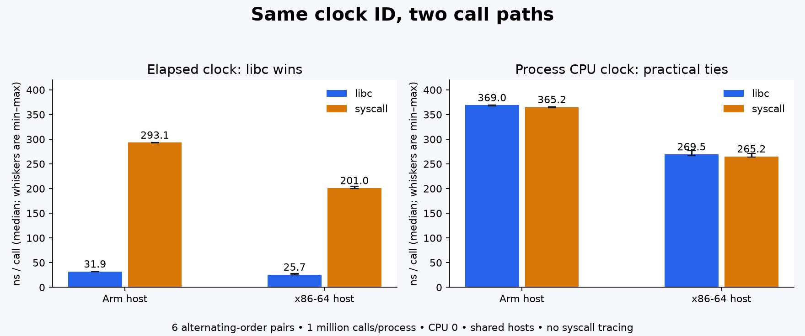

# Topic 082 measurements

Measured committed source: `41e8fc4491e8a79b08d5a276b6bcf230d26fea46`. Final source files on both hosts were
hash-checked against that commit before adding results. The initial committed
runner stopped after timing because strace was missing. Its data is retained
separately and excluded here. The final runner records that limitation and was
rerun in full; no sample was selected by its performance.

Both hosts: Amazon Linux 2023, Linux 6.12.111-136.204, glibc 2.34, GCC 11.5.0,
Rust 1.93.1/LLVM 21.1.8, fixed CPU 0 affinity. The Arm host is
`dev-dsk-ahrav-2b-7dc7bd93.us-west-2.amazon.com` (AArch64). The xxl alias resolved to
`dev-dsk-ahrav-2c-32182091.us-west-2.amazon.com`, verified x86_64,
Intel Xeon Platinum 8488C under KVM. Full live identity is in each host.json.

One million calls/process; one warmup per clock/mode; six alternating AB/BA pairs
per clock. Serial timed processes on each host; 4 warmups and 24 measured
processes per host. C flags: -O3 -std=c11 -Wall -Wextra -Werror, assertions enabled.
Other tenants, frequency, power state, interrupts and SMT siblings were not
controlled. No architecture-causality, production latency or isolation claim.

| Host / clock | libc ns/call median [min, max] | Forced syscall median [min, max] | Paired syscall/libc range | Decision |
|---|---:|---:|---:|---|
| arm / monotonic | 31.938 [31.896, 31.984] | 293.066 [292.438, 293.556] | 9.149–9.198 | libc wins |
| arm / cpu | 369.002 [367.869, 369.473] | 365.178 [364.273, 365.839] | 0.987–0.992 | practical tie |
| xxl / monotonic | 25.729 [25.716, 27.695] | 201.033 [200.278, 204.628] | 7.231–7.957 | libc wins |
| xxl / cpu | 269.514 [266.787, 277.331] | 265.200 [263.752, 271.437] | 0.955–1.014 | practical tie |

The practical tie band is [1/1.05, 1.05]. Every pair must meet the stated
win/tie rule. It is a descriptive rule, not a confidence interval. All process
observations and paired ratios are retained. CPU-time and elapsed-time clocks
serve different purposes; their absolute times are not interchangeable choices.

The results are consistent with a userspace fast path for monotonic libc reads.
This is an inference: strace is unavailable on both hosts, so this run has no
syscall-count observation. Explicit forced-syscall source establishes that
comparison's request path, but timing does not prove the libc implementation.
No direct vDSO-symbol probe, scheduler trace or timer precision campaign was run.

Each host passed six Rust unit tests, one doctest, Clippy, 864 independent Python
schedule-oracle cases, LT/ET/oneshot pipe probes, hot/cold/late delivery, EOF drain,
2,000 syscall/libc/syscall clock brackets, standard-signal coalescing and absolute
monotonic timerfd consumption. Clock brackets check consistency through different
entry paths, not correctness against an external time reference.

Local macOS passed the portable model and all six workspace commands from
DOCUMENTATION.md (including binary tests in the CI-equivalent test command).
Native probes are Linux-only. No root, reboot, host isolation, signal to another
process, or global policy change was needed.

