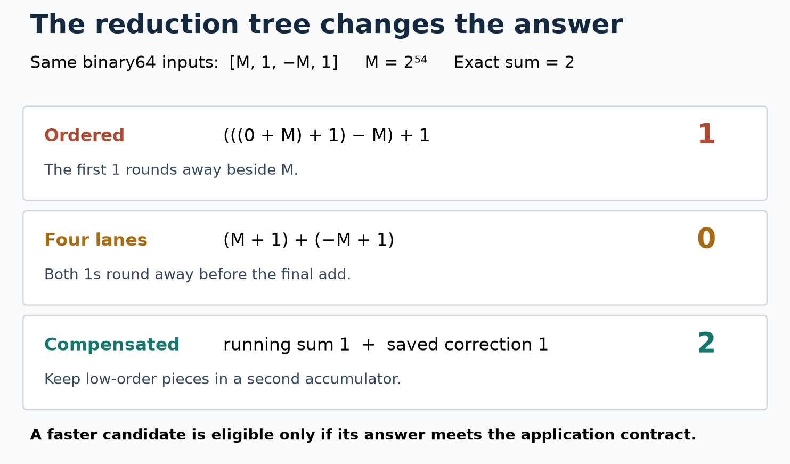

# What this lesson is trying to teach

Topic 085: **Floating-point semantics as an optimization contract.** Specify which
answers an optimization must preserve before changing numerical code. Evaluation
order, fused operations, exceptional values, and reproducibility belong in that
specification.

## If you remember only these things

- Addition order can change the answer. Multiple accumulators change the numerical algorithm.
- Accuracy and reproducibility are separate requirements.
- Fused multiply-add rounds once; separate multiplication and addition round twice.
- A scalar baseline checks evaluation-order compatibility. An independent mathematical oracle checks accuracy.
- Rank speed only among candidates that satisfy the same declared contract.

## A sum of sensor readings

A service adds signed sensor readings. Most are small; calibration adjustments
can be large. The exact mathematical sum and an existing left-to-right API can
require different answers.

Binary64 has a sign, an exponent setting scale, and 53 significant bits for normal
values. Representable numbers spread apart as magnitude grows. Arithmetic rounds
to a representable value, and later cancellation can expose information lost by
earlier rounding. See [Goldberg's tutorial][goldberg].

For `[M, 1, -M, 1]`, where `M = 2^54`, the mathematical sum is 2:



The rendered diagram was visually inspected before repository edits. Ordered
addition loses the first 1 and returns 1. Four lanes combine as `(M+1)+(-M+1)`
and return 0. Compensated addition retains a correction and returns 2 here.

Several accumulators shorten dependency chains and may allow vector execution.
Their final combination changes the addition tree. Some ordered reductions can
also vectorize without reassociation. Inspect the exact generated code.

## Write the contract

| Requirement | Decision |
|---|---|
| Domain | Admitted magnitudes, lengths, and nonfinite inputs; possible intermediate overflow |
| Accuracy | Ordered compatibility, application error budget, or correctly rounded exact result |
| Exceptional values | NaNs, infinities, signed zero, subnormals, and rejection policy |
| Repeatability | Same build, different CPUs, or different thread counts and partitions |
| Environment | Compiler, flags, instruction set, rounding assumptions, libraries |

NaN represents an invalid or unavailable numerical value. Infinity can arise from
overflow. Subnormals represent values below the normal exponent range. Positive
and negative zero compare equal, but reciprocals distinguish them. Arithmetic
NaN payload bits need not be deterministic in Rust; check classification when
that is the contract. [Rust's floating-point documentation][rust-float]

For finite values, test an application rule such as:

`abs(candidate-reference) <= absolute_budget + relative_budget*abs(reference)`.

Choose the budgets from the domain. Relative error alone fails near a zero sum.
An ULP is the spacing unit at a particular magnitude. ULP distance is useful,
but still needs a domain justification. Handle nonfinite values separately.

| Method | Useful contract | Cost or failure mode |
|---|---|---|
| Ordered sum | Existing left-to-right compatibility | Serial dependency; small contributions disappear |
| Several accumulators or pairwise tree | Reordering allowed; accuracy validated | Different rounding; partition-dependent results |
| Compensated sum | Improved accuracy when cancellation matters | More arithmetic; no universal exact-rounding guarantee; overflow limits |
| Wider accumulator | Lower-precision input with affordable wider arithmetic | Conversion/arithmetic cost; finite precision remains |
| Exact accumulator | Correct rounding independent of addition order | More state/complexity; define exceptional values |

A superaccumulator retains contributions across exponent ranges in a large
integer-like representation. It can sum finite inputs exactly and round once.
That contract is stronger than choosing a fixed parallel tree. Benchmark the
implementation rather than assuming its cost. [Neal's exact-summation paper][neal]

## Fusion and compiler permissions

With `a=1+2^-27`, `b=1-2^-27`, the exact value of `a*b-1` is `-2^-54`.
Separate multiplication rounds its product to 1 and returns zero after subtraction.
Rust `a.mul_add(b,-1)` rounds the whole expression once and returns `-2^-54`.
This changes a separate-rounding contract even though the answer is more accurate
for this expression. Dedicated hardware may help, but speed requires measurement.
[Rust mul_add][fma]

LLVM `contract` permits fusion; `reassoc` permits algebraic rearrangement. Other
flags permit ignoring zero signs, assuming no NaNs or infinities, reciprocal
transformations, or approximate functions. `fast` combines all fast-math flags.
Finite inputs alone do not establish finite intermediates. Compensation formulas
rely on their rounding steps, so broad algebraic rewrites can defeat them.
[LLVM fast-math semantics][llvm]

Flush-to-zero modes change subnormal results. This example leaves the default
floating-point environment unchanged. An FFI library changing that environment
requires an explicit integration contract; the default Rust operations here are
not a wrapper for arbitrary dynamic rounding modes or exception traps.

## Run the example

From the repository root, with Rust 1.93.1 installed:

```sh
cargo +1.93.1 run --release -p floating-point-contract -- demo
cargo +1.93.1 test -p floating-point-contract
```

Standalone, with the same source:

```sh
rustup run 1.93.1 rustc --edition 2024 -O topics/085-floating-point-contract/src/main.rs -o /tmp/topic85-demo
/tmp/topic85-demo demo
python3 topics/085-floating-point-contract/experiment/oracle.py /tmp/topic85-demo
```

Expected demo output:

```text
ordered=1 lanes4=0 compensated=2 exact=2
separate=0e0 fused=-5.551115123125783e-17
```

The complete [Rust source](src/main.rs) implements the three kernels, a bit-pattern
probe, benchmark mode, and five tests. The four-lane kernel uses chunks of four
with scalar tails; it preserves the same tree as distributing element `i` to lane
`i % 4`. The compensated kernel uses Neumaier's magnitude-based correction. Its
accuracy claims require finite inputs and non-overflowing intermediates. The tests
show that one infinity produces NaN in this implementation, so it is unsuitable
for an infinity-propagating API without a separate policy.

## Correctness before timing

The [Python oracle](experiment/oracle.py) uses exact rational arithmetic to sum
input bit patterns. It also rounds each rational addition to independently check
the ordered and four-lane trees. It checks 261 cases and 757 result values:
short and tail sizes, twelve deterministic seeds, cancellation permutations,
repeated cancellation blocks, and separate/fused rounding at 26 exponents.
NaN, infinity, signed zero, subnormals, and intermediate overflow have Rust tests.
These fixtures establish their specific claims, not a general compensation theorem.

The ordered and four-lane implementations deliberately fail exact-sum accuracy on
some cancellation cases. Those are expected counterexamples, not benchmark wins.
For a contract requiring exact sum 2 on the four-element fixture, compensation is
the only eligible candidate among these three.

The timed workloads use numerators `(i*37)%1024` (positive) or
`(i*73)%2048-1024` (signed), divided by 1024. The maximum length is `2^20`.
Each partial numerator has magnitude at most `2^30`, well below binary64's exact
integer range. Every addition and compensation residual is exact in this domain.
An integer-numerator oracle checks every benchmark process before and after timing.
Thus all three alternatives meet the same exact-answer contract for these workloads.
The arithmetic bound covers full benchmark sizes; rational fixtures check the
implementation independently on varied shorter inputs.

## Reproduce the performance experiment

```sh
python3 topics/085-floating-point-contract/experiment/run.py /tmp/topic85-results
python3 topics/085-floating-point-contract/experiment/analyze.py /tmp/topic85-results
```

The output directory must be new. The runner uses Rust 1.93.1, optimization level
3, native CPU targeting, one codegen unit, LTO off, and unwind panics. It pins one
Linux CPU and records source hashes, machine identity, compiler, CPU/cache data,
tests, oracle output, binary hash, assembly, and raw process timings.

Each host runs 216 measured processes: two distributions, sizes 256/65536/1048576,
three algorithms, and twelve blocks. Each block runs all algorithms; all six
candidate orders appear twice. Every process warms three passes and then processes
`2^24` items. Allocation, initialization, and correctness checks are outside the
timer. Calls, loop control, and black-box barriers remain inside. Shared-host
interference, uncontrolled frequency, and the single sampled host per architecture
limit interpretation. Subnormal performance and multithreading are unmeasured.

Before measuring, the descriptive rule is fixed: a pair has an observed winner
only if all twelve paired time ratios favor it by more than 5%. A practical tie
requires all ratios within a factor of 1.05; other cells are unresolved. Report
medians, min/max and all ratios. These are observed-run descriptions, not confidence
intervals or claims about a machine population.

See [results and limits](measurements/RESULTS.md). Timings and emitted code support
these kernel observations; they do not establish PMU-level causes or application
speedups. Only source and runner bytes from the recorded source commit are used
for final runs.

[goldberg]: https://docs.oracle.com/cd/E19957-01/806-3568/ncg_goldberg.html
[rust-float]: https://doc.rust-lang.org/std/primitive.f32.html
[fma]: https://doc.rust-lang.org/std/primitive.f64.html#method.mul_add
[llvm]: https://llvm.org/docs/LangRef.html#fast-math-flags
[neal]: https://arxiv.org/abs/1505.05571
