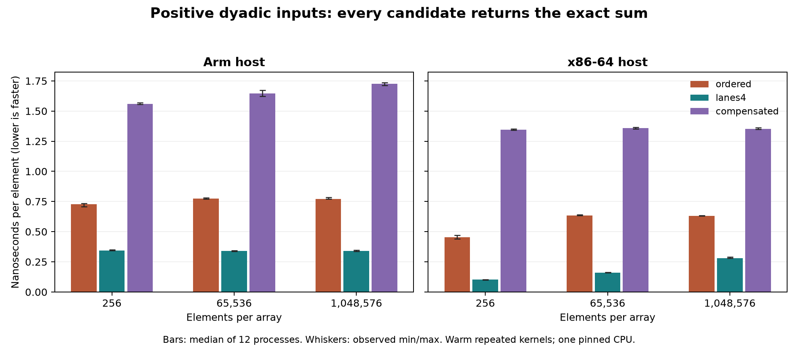

# Measured results: floating-point contracts

On the bounded exact-answer workloads, four lanes beat ordered accumulation and compensation in all twelve host/workload/size cells. Ordered accumulation beat compensation in every cell. All twelve paired ratios in each comparison cleared the predeclared 5% margin. There were no practical ties or unresolved pairs under this descriptive rule.

The cancellation fixture has a different admissible set: only compensation returns the required exact sum 2. The timings below cannot justify using a failing algorithm for that contract.

## Controls and identity

Measured source commit: `d6fd87a2ccc4c99f05b438b69ab4c956307b6fec`. [Source hashes](raw/source-identity.json) match both hosts' recorded inputs. `src/main.rs`, `oracle.py`, and `plot_model.py` retain these exact bytes. Later review commits change the runner's rustup lookup and add analyzer validation of block coverage, result agreement, positive timings, and distinct host names; the benchmark source, timed loop, and reported selections are unchanged, and the committed analyzer reproduces [summary.json](raw/summary.json) from the retained CSV files.

- Arm: dev-dsk-ahrav-2b-7dc7bd93.us-west-2.amazon.com, AArch64, Linux 6.12.111.
- xxl: resolved dev-dsk-ahrav-2c-32182091.us-west-2.amazon.com, verified x86_64, Intel Xeon Platinum 8488C, KVM, Linux 6.12.111.
- Both: Rust 1.93.1 / LLVM 21.1.8; optimization 3; native CPU target; one codegen unit; LTO off; unwind panics; one thread pinned to CPU 0.
- Each host: five unit tests, 261 oracle cases / 757 value checks, 216 timed processes, twelve balanced blocks per cell, three warmup passes and 2^24 timed items per process.
- Timer includes kernel calls, loop control, and black-box barriers. Allocation, initialization, warmup, and verification are excluded. Arrays are reused within each process.

## Observed timings

Values are nanoseconds per element: median [minimum, maximum] across twelve processes. Array sizes are 2 KiB, 512 KiB, and 8 MiB. Positive and signed distributions are defined in the lesson.

| Host | Workload | Elements | Ordered | Four lanes | Compensated |
|---|---|---:|---:|---:|---:|
| arm | positive | 256 | 0.7278 [0.7086, 0.7335] | 0.3436 [0.3425, 0.3509] | 1.5607 [1.5570, 1.5693] |
| arm | signed | 256 | 0.7290 [0.7125, 0.7392] | 0.3442 [0.3415, 0.3503] | 1.5578 [1.5568, 1.5648] |
| arm | positive | 65536 | 0.7737 [0.7713, 0.7812] | 0.3404 [0.3379, 0.3441] | 1.6452 [1.6241, 1.6716] |
| arm | signed | 65536 | 0.7720 [0.7712, 0.7864] | 0.3400 [0.3381, 0.3456] | 1.6413 [1.6107, 1.6596] |
| arm | positive | 1048576 | 0.7719 [0.7712, 0.7833] | 0.3400 [0.3381, 0.3456] | 1.7279 [1.7117, 1.7355] |
| arm | signed | 1048576 | 0.7717 [0.7710, 0.7807] | 0.3392 [0.3376, 0.3447] | 1.7257 [1.7172, 1.7313] |
| xxl | positive | 256 | 0.4539 [0.4416, 0.4706] | 0.1019 [0.1012, 0.1042] | 1.3469 [1.3422, 1.3534] |
| xxl | signed | 256 | 0.4452 [0.4417, 0.4576] | 0.1013 [0.1008, 0.1032] | 1.3427 [1.3423, 1.3500] |
| xxl | positive | 65536 | 0.6343 [0.6338, 0.6397] | 0.1615 [0.1609, 0.1631] | 1.3582 [1.3506, 1.3650] |
| xxl | signed | 65536 | 0.6345 [0.6341, 0.6418] | 0.1616 [0.1609, 0.1817] | 1.3553 [1.3500, 1.3600] |
| xxl | positive | 1048576 | 0.6315 [0.6306, 0.6356] | 0.2806 [0.2788, 0.2900] | 1.3522 [1.3496, 1.3631] |
| xxl | signed | 1048576 | 0.6313 [0.6309, 0.6363] | 0.2818 [0.2798, 0.2908] | 1.3567 [1.3510, 1.3614] |

Retained CSV rows use LF line endings and disassembly excerpts have trailing spaces removed; all values and instructions are preserved. Full original tool outputs are retained in the external evidence archive.

All pairwise ratios and selections are retained in [summary.json](raw/summary.json); individual measurements are in the host CSV files. The rule describes these observed blocks and supplies no population confidence interval.

## Emitted code and interpretation

The linked Arm binary uses SVE `fadda` for the ordered sum and separate ordered lane reductions for the four-lane kernel. This is direct evidence that an ordered floating reduction can use vector instructions. The x86 four-lane kernel uses packed YMM `vaddpd`; its ordered sum uses scalar `vaddsd`. Both compensated kernels retain correction arithmetic. FMA probes contain `fmadd` on Arm and `vfmadd213sd` on x86; separate probes contain separate multiply/add instructions.

These are final-image observations. We did not collect optimization remarks to attribute the vectorizer pass, PMU counters to establish a bottleneck, or controls that isolate an instruction-level cause. The experiment measures complete compiled kernels, including their chosen unrolling and instruction sequences.

## Limits and validation

The timed inputs have deliberately bounded exact partial sums. They show the performance cost of these implementations when they satisfy one shared contract. They do not measure broad real-world error distributions, subnormal throughput, multithreading, cold memory, or application latency. CPU frequency and co-tenant load were uncontrolled; one machine per architecture does not support an architecture-wide ranking. Compensation is not claimed to correctly round arbitrary finite sums.

Initial host probes succeeded. First campaign attempts encountered SSH proxy timeouts before measurement began. One bounded retry per host completed the exact-source runs. No Linux measurement remains missing.

All six repository CI commands passed locally: formatting, workspace Clippy with warnings denied, unit/binary/example tests, doctests, benchmark compilation, and documentation with warnings denied. Hosted CI status is recorded separately at publication.

The standalone diagram was rendered and inspected. A timing plot shows the median and observed range for positive inputs; signed inputs remain in the table and raw data.

