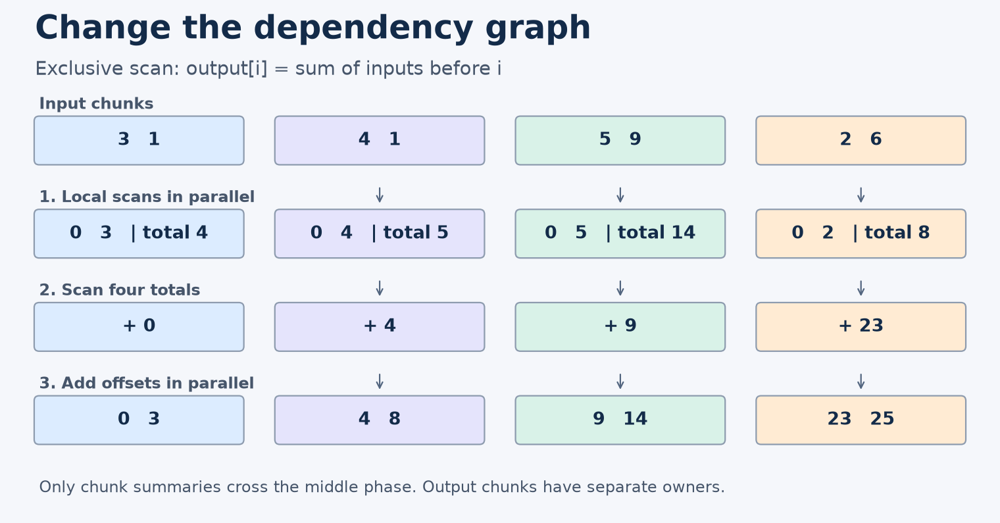
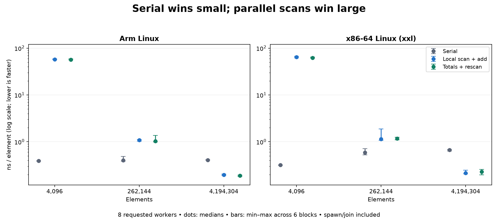

# What this lesson is trying to teach

**Topic 86: Parallel algorithm design beyond parallel loops.**

Parallel speed comes from exposing independent work. A running sum seems sequential,
but chunk summaries let us change its dependency graph while preserving input order.
This lesson was taught before repository edits. The results below were added after
running the committed implementation on both required Linux hosts.

## If you remember only these things

- Count total work and the longest dependency chain separately.
- Summarize chunks, combine summaries, then finish independent output regions.
- Prove regrouping preserves the answer. Associativity permits regrouping, while
  operand order may still matter.
- Give each output region one writer and define when consumers may observe it.
- Count coordination and data movement. A shorter dependency chain can still lose.

## One running example

Records with lengths `[3,1,4,1,5,9,2,6]` need starting offsets
`[0,3,4,8,9,14,23,25]`. This is an **exclusive scan**: output i sums inputs before i.
An inclusive scan includes input i. A reduction returns one aggregate, here 31.

The serial loop carries one running total. Every iteration depends on its predecessor.
A mutex around that total preserves serialization. Atomic fetch-add assigns offsets
in execution order, which need not preserve record order.
[Original scan definition and applications](https://www.cs.cmu.edu/~guyb/papers/Ble93.pdf).

## Work and span

Represent operations as graph vertices, with dependency edges between them.
**Work W** counts all operations. **Span S** counts the longest dependency path.
With p processors, runtime is at least max(W/p,S). An ideal greedy schedule is bounded
by W/p+S. The ratio W/S bounds average available parallelism in that model. Hardware,
scheduling, and memory costs must be represented or measured separately.
[CMU's model and assumptions](https://www.cs.cmu.edu/afs/cs/academic/class/15210-f17/www/concurrency.html).

The serial scan has O(n) work and O(n) span. Adding processors alone changes neither.

## Change the dependency graph

1. Scan each ordered chunk from zero and retain its total.
2. Exclusively scan those totals to obtain chunk offsets.
3. Add each chunk offset to its local prefixes.



The totals are `[4,5,14,8]`; their prefixes are `[0,4,9,23]`. The third chunk's
local prefixes `[0,5]` become `[9,14]`. Every global prefix splits into all earlier
chunks plus earlier values within this chunk. The offset supplies the first part;
the local scan supplies the second.

For b balanced chunks, the implementation does O(n+b) work. Its span is O(n/b+b),
including the serial summary scan and spawn loops. A parallel tree over summaries
can shorten that stage when its task graph and synchronization support execution.
Chunk count and processor count are distinct choices.

## Alternatives and costs

| Design | Work | Span | Choose it when |
|---|---|---|---|
| Serial | O(n) | O(n) | Input is small or setup dominates |
| Local scan, then offsets | O(n+b) | O(n/b+b) here | Simple local prefix ownership is useful |
| Totals, then rescan input | O(n+b) | O(n/b+b) here | Reading input twice is preferable to rewriting output |
| Balanced up/down tree | O(n) | O(log n) with parallel tree execution | More parallelism justifies synchronization |
| Doubling scan | O(n log n) | O(log n) | Extra work suits a small hardware group |

The tree combines values upward and distributes prefixes downward. Doubling combines
progressively more distant neighbors each round. Short parallel depth does not imply
low total work. [Scan algorithms](https://developer.nvidia.com/gpugems/gpugems3/part-vi-gpu-computing/chapter-39-parallel-prefix-sum-scan-cuda).

For our u64 loops, a source-level traffic model gives 16 bytes/item for serial,
32 for local/add, and 24 for totals/rescan, excluding summaries. These are logical
accesses. Cache reuse, write allocation and code generation change physical traffic.
The measured API also pays for scratch allocation and two waves of thread creation
and joining. A persistent pool would need its own comparison.

GPU decoupled-look-back scan trades redundant local work for fewer global transfers.
It illustrates another design choice; this experiment does not test that algorithm.
[Original paper](https://research.nvidia.com/sites/default/files/pubs/2016-03_Single-pass-Parallel-Prefix/nvr-2016-002.pdf).

## Runnable code

The example uses addition modulo 2^64, which is associative. A real allocator must
reject sums exceeding its destination capacity before treating them as offsets.
Floating-point addition needs a separate accuracy and reproducibility contract.
Associativity changes parentheses; a generic scan still preserves operand order.

`chunks_mut` supplies disjoint mutable regions. Each scope joins its worker functions
before the next phase consumes their results. The example has no thread-local
destructors in its synchronization contract.
[Rust scoped threads](https://doc.rust-lang.org/std/thread/fn.scope.html).

```rust
use std::thread;

fn scan(input: &[u64], workers: usize) -> Vec<u64> {
    assert!(workers > 0);
    let mut output = vec![0; input.len()];
    if input.is_empty() { return output; }
    let width = input.len().div_ceil(workers);
    let mut totals = vec![0u64; input.len().div_ceil(width)];
    thread::scope(|s| {
        for ((src, dst), total) in input.chunks(width)
            .zip(output.chunks_mut(width)).zip(totals.iter_mut()) {
            s.spawn(move || {
                let mut sum = 0u64;
                for (&x, y) in src.iter().zip(dst) {
                    *y = sum;
                    sum = sum.wrapping_add(x);
                }
                *total = sum;
            });
        }
    });
    let mut base = 0u64;
    for total in &mut totals {
        let next = base.wrapping_add(*total);
        *total = base;
        base = next;
    }
    thread::scope(|s| {
        for (dst, offset) in output.chunks_mut(width).zip(totals) {
            s.spawn(move || {
                for y in dst { *y = y.wrapping_add(offset); }
            });
        }
    });
    output
}

fn main() {
    let input = [3, 1, 4, 1, 5, 9, 2, 6];
    let expected = [0, 3, 4, 8, 9, 14, 23, 25];
    for workers in [1, 2, 3, 4, 16] {
        assert_eq!(scan(&input, workers), expected);
    }
    assert_eq!(scan(&[], 4), []);
    assert_eq!(scan(&[u64::MAX, 1, 2], 2), [0, u64::MAX, 0]);
    println!("{:?}", scan(&input, 4));
}
```

Save or download `demo.rs`, then run:

```bash
rustup run 1.93.1 rustc --edition=2024 -O demo.rs -o scan-demo
./scan-demo
```

Expected output: `[0, 3, 4, 8, 9, 14, 23, 25]`.

The source bundle contains all three implementations and the experiment scripts.
From its topic directory, with Rust 1.93.1 installed:

```bash
bash scripts/build.sh
./build/probe demo
python3 scripts/run.py ./build/probe build/results
python3 scripts/analyze.py build/results/raw.csv > build/results/summary.json
```

`build.sh` runs five tests and the Python oracle. `demo` prints the same array for
serial, local and rescan, each with total 31. The Linux runner requires CPUs 0..7
available; inspect topology before replay. Source, scripts and raw results are retained.

## Correctness and failure modes

The Rust tests use independent u128 prefix slices. The Python oracle uses arbitrary-
precision sums of prefixes, reduced modulo 2^64. It covers empty inputs, uneven
chunks, full-width random integers and overflow. Benchmark outputs use a separate
closed-form triangular-number oracle. Every final output is checked outside timing.

A wrong exclusive/inclusive convention shifts destinations. An invalid regrouping
changes arithmetic results. Equal-length chunks balance fixed-cost addition, but
variable-cost records can leave one worker with most of the work. Finer tasks trade
balance against dispatch and summary overhead.

Disjoint writes prove separate ownership, but adjacent chunks can still share cache
lines. Keep output private until all required workers finish successfully. Failed
workers can leave partial contents; join outstanding writers before reclaiming storage
and publish only according to the declared failure contract.

The same pattern gives stable filtering: classify records, scan keep flags, scatter
kept records to their unique ordered positions. Histograms and radix partitioning also
separate local work, summaries and placement. Prove each phase's ownership and
visibility boundary before choosing its scheduling machinery.

## Measurements

Measured source: `6c20563db07c983155ba4c7bb6247d92bbda9d7a`.
Both Linux hosts used Rust 1.93.1 / LLVM 21.1.8, native opt3, one codegen unit,
LTO off and unwind. Source hashes matched on both hosts.

- Arm: `dev-dsk-ahrav-2b-7dc7bd93.us-west-2.amazon.com`, Linux aarch64.
- xxl resolved to `dev-dsk-ahrav-2c-32182091.us-west-2.amazon.com`, verified x86_64,
  Intel Xeon Platinum 8488C under KVM.

Every candidate inherited CPU0..7 affinity. Workers could migrate within that set;
frequency and background load were uncontrolled. Inputs were `1..=n`. For each of
three sizes and worker counts 1/4/8, six blocks covered all six candidate orders.
Each fresh process performed two warmups and 16/8/4 timed calls for small/medium/large.
Scratch allocation, summaries, data passes and thread spawn/join were timed. Input
and output allocation, first-touch, verification and printing were outside timing.

Each host passed five Rust tests and 378 oracle cases covering 10,719 values.
Each completed 162 measured processes and two A/A processes. No measurement attempt
failed or was discarded. All final benchmark outputs passed their formula oracle.

Median ns/item at eight requested workers, with min–max over six blocks:

| Host / elements | Serial | Local/add | Totals/rescan |
|---|---:|---:|---:|
| Arm / 4,096 | 0.389 [0.388–0.390] | 57.626 [56.442–59.051] | 56.817 [56.204–59.199] |
| Arm / 262,144 | 0.403 [0.386–0.487] | 1.092 [1.028–1.118] | 1.038 [0.988–1.373] |
| Arm / 4,194,304 | 0.408 [0.404–0.412] | 0.195 [0.192–0.203] | 0.188 [0.183–0.193] |
| x86 / 4,096 | 0.317 [0.317–0.318] | 64.349 [62.154–66.901] | 62.194 [60.946–64.262] |
| x86 / 262,144 | 0.585 [0.526–0.715] | 1.142 [1.076–1.874] | 1.171 [1.095–1.257] |
| x86 / 4,194,304 | 0.668 [0.635–0.688] | 0.214 [0.208–0.247] | 0.229 [0.195–0.257] |



Serial wins every small-input cell. Both parallel scans beat serial at 4,194,304
values with four or eight workers. The comparison between those parallel methods
remains unresolved in the large-input cells.

The rule was fixed before measurement: every paired ratio must clear 5% for a winner;
all ratios inside that margin mean a practical tie; mixed evidence stays unresolved.
Arm local/add versus rescan ties at small/four and small/eight, and x86 at small/four.
Rescan wins against local/add at Arm medium/one and x86 medium/four. Other pair details
and every raw ratio are in `measurements/results.md` and the source bundle.

These are descriptive results from shared hosts. A/A ratios were 0.941 on Arm and
1.215 on x86, so two identical-artifact runs were insufficient to establish noise
calibration. There are no population confidence claims, measured DRAM traffic,
proven hardware bottlenecks, persistent-pool results, or universal winner. The
work-span and traffic models are derivations; attributing a timing difference to a
particular hardware mechanism remains inference.

## Publication and next lesson

See [validation](measurements/validation.md) and [all results](measurements/results.md). The next lesson is **87: Work-stealing schedulers
and task granularity**.
