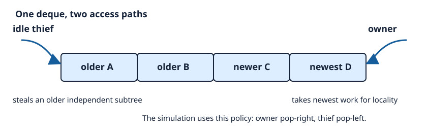

# Work-stealing schedulers and task granularity

## What this lesson is trying to teach

Work stealing distributes irregular parallel work without assigning every task centrally. Task granularity determines whether balancing pays for its scheduling cost.

## If you remember only these things

- A task must repay queue, steal, synchronization, and locality costs.
- Owners take newer local work. Thieves take older work that can run independently.
- A recursive cutoff controls the number of tasks and the available parallelism.
- Static chunks fit uniform work. Work stealing fits uneven work.
- A speedup claim requires a measured runtime under a declared workload. This lesson retains both an accounting model and a bounded runtime comparison.

## Terms

A **work-stealing scheduler** gives each worker a deque. The owner pushes and takes work at one end. An idle worker steals from the opposite end of a victim deque. **Granularity** is useful work per scheduled task. The **critical path** is the longest chain of dependent work, which sets a lower bound on elapsed time.

## Running example

The accounting model evaluates a full binary tree. Most leaves cost one unit and deterministic outliers cost 100 units. It compares contiguous static leaf blocks with a work-stealing schedule. Both must equal the serial oracle.



The visual is an inspected SVG. The implementation follows its rule: an owner pops the rightmost task and a thief removes the leftmost task.

## Cost model and choice

A rough cost checklist is `parallel time ≈ useful work / workers + critical path + task_count × scheduler_cost + imbalance/locality cost`. These terms can overlap; use measured wall time for selection. The expected work-stealing bound applies to the paper's fully strict computation and randomized scheduler assumptions.

Use static chunks for known equal-cost work. Use work stealing for recursive or data-dependent work with uneven costs. Increase the cutoff when task administration dominates. Decrease it when idle workers remain while a long task runs. Production implementations also need correct concurrent deque synchronization, memory reclamation, cancellation rules, and NUMA-aware victim policy.

## Run it

```bash
python3 work_stealing_demo.py --self-test
python3 work_stealing_demo.py --depth 14 --cutoff 6 --workers 4
cc -std=c11 -O3 -Wall -Wextra -Werror -pthread work_stealing_bench.c -o work_stealing_bench
./work_stealing_bench --self-test
./work_stealing_bench --n 32768 --workers 4 --grain 64 --rounds 8 --skew 16 --reps 5
```

The Python self-test counts and reports its 325 depth, cutoff, and worker combinations. It is an accounting model.

The C benchmark has three correct alternatives: serial execution, static contiguous partitioning, and a safe mutex-protected work-stealing scheduler. It runs each mode five times in rotating order and prints elapsed nanoseconds, checksum, and steals. The 72-case self-test checks that all three return the same checksum. The benchmark intentionally uses mutexes and front-removal by `memmove`; it measures this simple implementation, not a lock-free deque or a production runtime.

### Validate and measure

```bash
python3 scripts/validate.py
python3 scripts/run_campaign.py --source-commit "$(git rev-parse HEAD)" --output measurements/local
```

The validation uses a separately implemented Python integer oracle and a forced
split-publication interleaving. The outstanding count includes queued tasks and
tasks being executed or split. Increment it before publishing either child;
otherwise the first child can finish and expose zero while its sibling is still
unpublished. A checksum alone misses the resulting premature worker exit.

The campaign compares fresh processes in all six mode permutations for each
grain and workload. Each process performs one measured invocation. Parallel
timings include allocation, pthread creation, computation, joins and cleanup.
The Linux runner restricts the process and its workers to four distinct cores
on one NUMA node, while allowing migration within that set.

See [measurement results](measurements/results.md) for source identity, raw
observations, variability and the measured selection. Earlier local timings used
the source before the completion-accounting fix and remain historical evidence.

### Ownership and limits

The benchmark owns each deque under a mutex and transfers a range on removal.
Every item contributes once to an unsigned 64-bit sum. Task ownership follows
the deque transfer; mutable task state must remain exclusive through that transfer.
This CPU-only example completes all work before returning. Cancellation, blocking
tasks, persistent worker pools, lock-free reclamation and NUMA-aware victim
selection require separate runtime contracts. Its deterministic victim order,
shared sum atomic and front-removal cost limit performance generalization.

## Sources

- [Blumofe and Leiserson, Scheduling Multithreaded Computations by Work Stealing](https://doi.org/10.1145/324133.324234)
- [Chase and Lev, Dynamic Circular Work-Stealing Deque](https://doi.org/10.1145/1073970.1073974)
- [OpenCilk documentation](https://www.opencilk.org/doc/)

## Cutoff selection

A lower cutoff raises task count and scheduler work. More available tasks only help while workers have useful parallel work that exceeds those costs.
