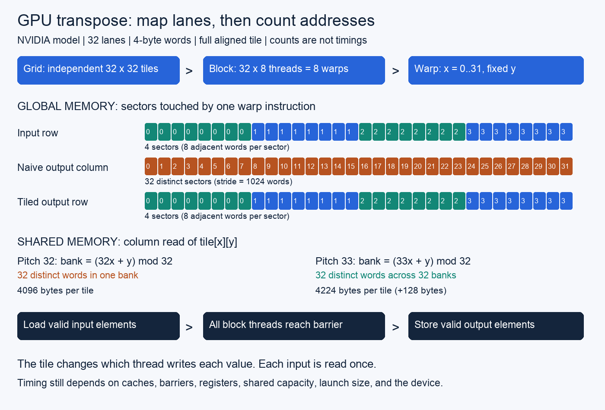

# GPU execution mechanics

Out-of-place transpose models compare direct writes with shared tiles of pitch
32 and 33. All variants preserve `B[c * rows + r] = A[r * cols + c]`.
The CUDA kernels use 32-by-8 blocks, four elements per thread, independent blocks,
64-bit flattened indices, guarded edge accesses, and a barrier reached by every
thread. Inputs and outputs occupy separate buffers. Empty shapes skip launch.



## Run

From the repository root:

```sh
cargo test -p gpu-execution-mechanics
cargo run --release -p gpu-execution-mechanics --example model
python3 topics/088-gpu-execution/model.py
```

The Rust tests compare 13,068 transpose results over all 4,356 rectangular shapes
with dimensions 0 through 65. An output-major oracle is independent of tile and
thread indexing. Another 11,200 cases compare sector intervals with byte-by-byte
enumeration. Shared reads require initialized producers; output writes require
unique ownership. Python independently checks 8,712 tiled outputs.

The model prints sector counts 4, 5, and 32 for aligned, one-word-shifted, and
1024-word-strided access. Pitch-32 and pitch-33 columns have bank depths 32 and 1.
These counts assume 32 lanes and scalar four-byte accesses. Repeated shared reads
of the same word broadcast in this model. Counts describe addresses, not timing.

## CUDA validation and measurement

On a host with a visible supported NVIDIA GPU and CUDA toolkit:

```sh
cd topics/088-gpu-execution
nvcc -O3 -std=c++17 -lineinfo -Xptxas=-v -arch=native cuda/transpose.cu -o transpose
./transpose --check
compute-sanitizer --tool memcheck --error-exitcode 1 ./transpose --check
compute-sanitizer --tool racecheck --error-exitcode 1 ./transpose --check
compute-sanitizer --tool synccheck --error-exitcode 1 ./transpose --check
./transpose > cuda-results.csv
```

`-arch=native` selects the visible local device. Deployment builds require
explicit architecture targets. Device runs remain pending; see [results](measurements/results.md).

Correctness mode covers empty, singleton, skinny, rectangular, tile-boundary,
1023-by-1025, and 1024-by-1024 shapes. Timing adds 4096-by-4096. Each nonempty
shape checks all three variants against an output-major CPU oracle. The driver
checks CUDA API failures, immediate launch errors, and execution completion.

Timing uses nine rotated samples per variant and shape, five warmups per sample,
and 50 launches per CUDA-event interval. All raw samples and min/median/max are
printed. Allocations and transfers occur outside each timed interval. Inputs and
outputs are reused, so cache state is warm and depends on working-set size.
Clock and power policy stay at host defaults; record them and concurrent load.
The kernel batch can include host submission gaps for short kernels. Report
`2 * elements * sizeof(uint32_t) / seconds` as effective bandwidth. It counts
useful bytes, not measured DRAM traffic. Measure caller transfers separately.

Full aligned tiles at width 1024 have four input sectors per warp instruction.
Direct stores touch 32 sectors; both tiled stores touch four. Padding changes
shared column bank depth from 32 to one and increases shared bytes from 4096 to
4224. Query actual resource use and residency, then measure each input shape.
Keep performance conclusions conditional on the device and execution regime.

## Sources

- [CUDA programming model](https://docs.nvidia.com/cuda/cuda-programming-guide/02-basics/intro-to-cuda-cpp.html).
- [SIMT and independent thread scheduling](https://docs.nvidia.com/cuda/cuda-programming-guide/03-advanced/advanced-kernel-programming.html).
- [Global access coalescing](https://docs.nvidia.com/cuda/cuda-c-best-practices-guide/index.html#coalesced-access-to-global-memory).
- [NVIDIA transpose example](https://developer.nvidia.com/blog/efficient-matrix-transpose-cuda-cc/), historical mechanism reference.
- [Shared banks and profiling limits](https://docs.nvidia.com/nsight-compute/ProfilingGuide/index.html).
- [Occupancy API](https://docs.nvidia.com/cuda/cuda-runtime-api/group__CUDART__OCCUPANCY.html).
- [Compute Sanitizer](https://docs.nvidia.com/compute-sanitizer/ComputeSanitizer/index.html).

Sources checked 2026-10-25. CPU simulations verify address and ownership rules.
CUDA compilation, ordering, generated instructions, and performance require
separate device evidence.
