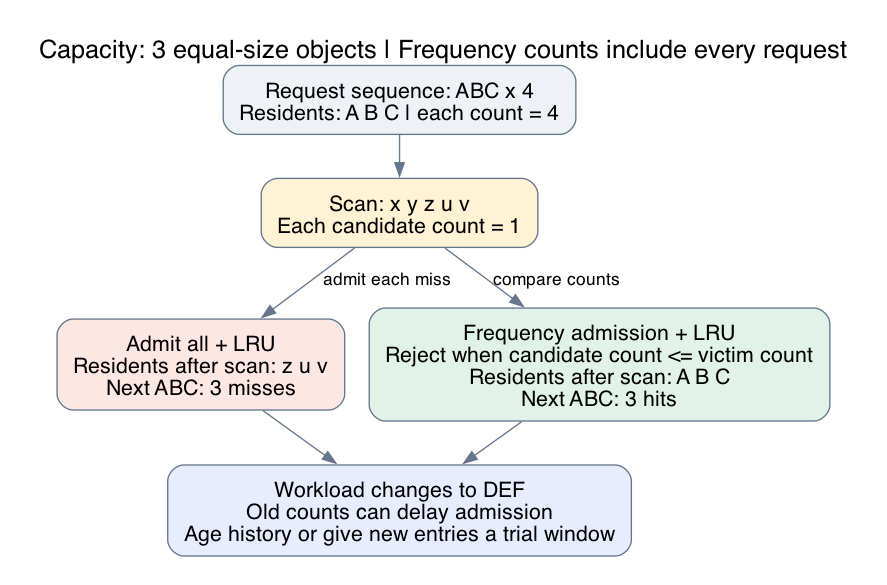

# What this lesson is trying to teach

A software cache has limited capacity. Its policy must decide which objects
deserve that capacity, how quickly it responds to changing demand, and how much
work it performs on each request.

Topic 91 uses a cache of three equal-size objects. Requests first favor A, B,
and C, then scan unrelated objects, then change to a new working set.

## If you remember only these things

- Admission and eviction are separate decisions. Eviction selects a resident
  to remove. Admission decides whether the incoming object merits that removal.
- Recent use and frequent use answer different questions. Recency responds
  quickly to change. Frequency protects entries during scans, but old counts
  can delay adaptation.
- Hit ratio and implementation cost both matter. Shared metadata updates on
  every hit can consume CPU and limit concurrency.
- Capacity and value need explicit units. Entry count, bytes, backend work,
  and latency can favor different policies.
- Test request order and phase changes. A popularity histogram loses ordering.

## The problem

A hit finds a valid resident object. A miss requires loading or computing it.
The working set is the group of objects reused during a stated interval. A
scan requests many distinct objects with little immediate reuse.

Assume equal-size objects, equal miss costs, immediate successful loads, and
no expiry or invalidation. Capacity is three objects. These assumptions let
us compare request misses directly.

Start with ABC repeated four times. The cache holds A B C, each with four
references. Now request x y z u v once each. Least recently used (LRU) removes
the resident with the oldest last access. Admission on every miss lets the
scan replace all three useful entries. The next ABC produces three misses.

Frequency admission compares the incoming count with the selected victim's
count. Each scan object has count one. Rejecting candidates whose counts are
no greater than the victim's preserves A B C. The next ABC produces three
hits. The rejected request still needs its result from the backend.



The diagram was rendered with Graphviz and visually inspected before repository
edits. It illustrates the exact-count demonstration below.

Now demand changes to DEF. Persistent counts favor old residents and delay
admission of the new working set. Aging reduces old reference counts. A
recency window gives new objects temporary space to demonstrate reuse.

TinyLFU uses compact estimates of recent frequency to decide admission.
W-TinyLFU combines a recency window, frequency admission, and a segmented main
cache. Our exact-count example exposes the admission decision.
[TinyLFU paper](https://arxiv.org/abs/1512.00727)

## Alternatives and selection criteria

| Policy | Decision and maintenance | Useful signal | Main failure mode |
| --- | --- | --- | --- |
| FIFO | Evict oldest insertion; hits preserve order | Low bookkeeping budget | Frequently used old objects can leave |
| LRU | Evict oldest access; hits update order | Short-term reuse | Scans replace useful residents; shared order can contend |
| Aged frequency admission + LRU | Compare counts before replacing LRU victim | Popular objects mixed with one-use objects | Aging interval and ties affect adaptation |
| W-TinyLFU | Trial window, admission, segmented recency | Mixed recency and frequency | Partitions and history add metadata and tuning |
| S3-FIFO | Small probationary queue, main queue, evicted-key history | Little reuse before eviction | Queue allocation affects delayed reuse |
| SIEVE | Insertion order, visited bits, eviction cursor | Low-cost hit recording | Test scan-heavy workloads separately |

S3-FIFO filters objects through a small queue before they occupy its main
region. Its history queue keeps keys without cached values. SIEVE records
visits and makes retention decisions while scanning for a victim. These
mechanisms reduce eager list movement on hits. Published results describe
the authors' workloads and implementations.
[S3-FIFO](https://s3fifo.com/blog/2023/08/01/fifo-queues-are-all-you-need-for-cache-eviction/),
[SIEVE](https://www.usenix.org/publications/loginonline/sieve-cache-eviction-can-be-simple-effective-and-scalable)

Start with FIFO and LRU as simple baselines. Add admission when traces show
low-reuse objects displacing repeated keys. Include phase changes when choosing
an aging horizon. For a deployment decision, add Random and an appropriate
offline bound, sweep capacities, and test the actual concurrent implementation.
The four-policy teaching experiment isolates two admission choices; it does
not establish an optimal policy.

In a concurrent cache, lookup and policy updates have separate costs. Caffeine
buffers read records and batches maintenance. Some read records can be dropped
because they influence replacement quality. Correct insertion and removal
bookkeeping has stronger requirements.
[Caffeine design](https://github.com/ben-manes/caffeine/wiki/Design)

## Capacity, cost, and correctness

For request rate R and hit fraction h, backend request rate is approximately
R(1-h), assuming each miss causes one backend request. Coalescing duplicate
misses changes that relationship.

Average service work = lookup and policy work + (1-h) * miss work.

Suppose a candidate adds 40 ns of policy work and avoids misses costing 20 us.
The modeled break-even improvement is 40/20000 = 0.002, or 0.2 percentage
points of hit rate. These illustrative assumptions do not predict queueing
delay or tail latency.

With variable-size objects, one candidate may displace several residents.
Compare its expected saved work against the aggregate benefit of the complete
victim set. A byte limit controls occupancy; it does not automatically optimize
bytes served or backend work. Rejecting an oversized object needs explicit
behavior. Pinned or dirty entries can restrict victim eligibility.

Measure request hit ratio, byte hit ratio, miss cost, metadata memory, policy
CPU, and throughput at the required concurrency. Define expiry, invalidation,
failed loads, in-flight fills, and stale maintenance behavior. Delayed work
for an old entry must not remove a newer generation of the same key. Values
must satisfy the freshness contract regardless of replacement quality.

## Runnable example

Save this as demo.py:

```python
from collections import OrderedDict, Counter

def replay(trace, policy, capacity=3):
    cache, count, hits = OrderedDict(), Counter(), 0
    for key in trace:
        count[key] += 1
        if key in cache:
            hits += 1
            if policy != "fifo":
                cache.move_to_end(key)
        elif capacity:
            if len(cache) == capacity:
                victim = next(iter(cache))
                if policy == "frequency" and count[key] <= count[victim]:
                    continue
                cache.popitem(last=False)
            cache[key] = None
    return hits, "".join(cache)

scan = list("ABC" * 4 + "xyzuv" + "ABC" * 2)
for name, trace in [("scan", scan), ("shift", scan + list("DEF" * 3))]:
    for policy in ["fifo", "lru", "frequency"]:
        print(name, policy, len(trace), *replay(trace, policy))
```

Run `python3 demo.py`. Checked output:

```text
scan fifo 23 12 ABC
scan lru 23 12 ABC
scan frequency 23 15 ABC
shift fifo 32 18 DEF
shift lru 32 18 DEF
shift frequency 32 15 ABC
```

Columns are workload, policy, requests, hits, and final residents in eviction
order. Frequency admission wins the scan trace, 15 hits versus 12. After the
change, FIFO and LRU finish with 18 hits versus 15. These are deterministic
trace results. The script keeps history for every observed key and never ages
it. Production history needs bounded storage and an explicit aging rule.

## Native validation and measurement

The native experiment compares FIFO, LRU, persistent frequency admission with
LRU, and aged frequency admission with LRU. Workloads cover a fitting hot set,
scans, phase changes, a capacity-exceeding loop, and uniform requests.

A separate timestamp simulator checks hit decisions and resident order against
the native linked-array implementation. Keys occupy a bounded integer universe,
which removes hash-function variation and limits the scope of timing claims.
The README specifies exact counter semantics, workload sizes, memory, timing
boundaries, process ordering, commands, and the descriptive decision rule.

Final measurements use committed source, identical traces, fresh processes,
balanced order, and repeated samples on the declared Arm Linux, x86-64 Linux,
and local macOS hosts.
Exact misses and measured timing variability are reported separately in
RESULTS.md. Concurrent throughput, real backend latency, and production
cache-library rankings remain unmeasured.
