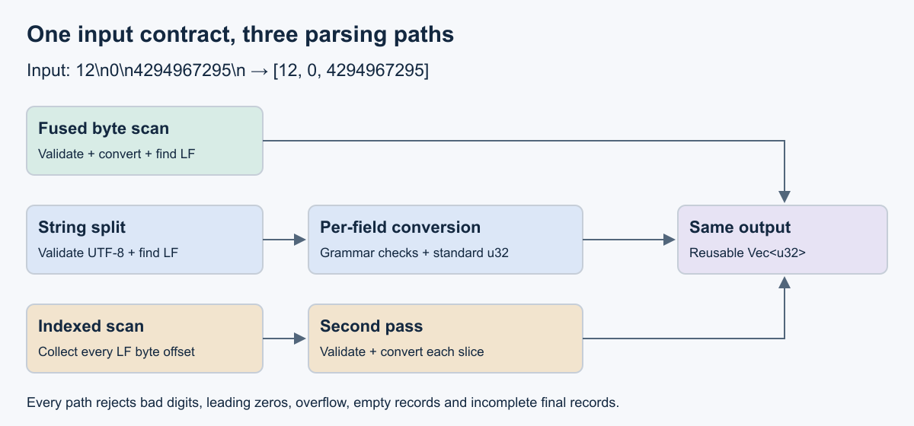

# What this lesson is trying to teach

Topic 092: High-throughput parsing and validation.

Parsing converts bytes into useful values while enforcing the input contract.
This lesson compares three implementations of a strict decimal counter format.

## If you remember only these things

- Define accepted bytes, numeric limits, framing and errors before optimizing.
- Delimiter detection, grammar validation and value conversion are distinct work.
- SIMD can accelerate classification; conversion and output costs still matter.
- Compare implementations with identical acceptance rules and output values.
- Measure valid throughput and malformed-input rejection latency separately.

## Contract and running example

A telemetry batch holds one unsigned 32-bit counter per LF-terminated record.
The grammar is `(0|[1-9][0-9]*)\n`, repeated zero or more times. Each value must
fit in `0..=4294967295`. Empty input means zero records. Every nonempty record
requires its final LF byte, decimal 10.

`12\n0\n4294967295\n` produces `[12, 0, 4294967295]`. Leading zeros, signs,
spaces, CRLF, Unicode digits, empty records, overflow and incomplete final
records are rejected. All implementations clear the output vector on error.
Callers publish a batch only after success. Resource limits belong at the caller:
cap batch bytes, record count and retained memory before accepting large inputs.

This restricted ASCII protocol overlaps with JSON integer spelling. JSON also
supports fractions, exponents and other value types. See
[RFC 8259](https://www.rfc-editor.org/rfc/rfc8259.html).



The PNG was rendered from the retained SVG and visually inspected before teaching.

## Three implementations

| Path | Work | Selection criteria |
|---|---|---|
| Fused | One byte scan validates, converts and emits at LF | Small stable grammar; worthwhile measured gain |
| Split | Validate UTF-8, split strings, check spelling, standard u32 conversion | Clear library baseline that meets the budget |
| Indexed | Scalar LF scan into offsets, then validate and convert slices | Boundaries reused by later work or independent record processing |

A fused scan combines operations in one traversal. A structural index records
positions of meaningful bytes. On a 64-bit target, one million `usize` offsets
occupy about 8 MB. One million output `u32` values occupy another 4 MB, excluding
vector headers, excess capacity and input. The index adds reads and writes.
Two passes can repay their cost by simplifying later work; measurement decides.
The indexed example uses scalar source and makes no SIMD code-generation claim.

## SIMD and validation scope

SIMD applies one instruction to multiple values. A scanner can compare a block
of bytes with punctuation and form a bit mask of matching positions. JSON also
needs quote state and the parity of backslash runs, including runs crossing a
block boundary. The simdjson paper describes structural scanning followed by
value processing. See [Langdale and Lemire](https://arxiv.org/html/1902.08318v7).

UTF-8 validation checks permitted byte sequences encoding Unicode characters.
SIMD implementations classify lead and continuation bytes with boundary state.
Our parser establishes its restricted encoding by accepting only ASCII digits
and LF. General text requires the appropriate encoding rules. See
[Keiser and Lemire](https://arxiv.org/abs/2010.03090).

Simdjson On-Demand validates accessed values and the structure traversed to reach
them. Reading one selected field does not establish full-document validity.
Choose complete traversal or a validating interface when the service requires
complete validation. See the [API contract](https://simdjson.org/api/4.6.4/md_doc_2basics.html).

## Run the example

From this directory:

```bash
python3 demo.py
cargo test -p parsing-validation
python3 test_experiment.py
cargo build --release -p parsing-validation
python3 experiment.py ../../target/release/parsing results/local
```

The example writes to `results/local`, a scratch directory, so the committed
artifacts in `measurements/<host>/` remain unchanged. `test_experiment.py` runs
the runner against fake binaries whose output differs from the oracle and
requires rejection with and without `python3 -O`.

The demo prints `[12, 0, 4294967295]` for the valid batch and rejects `01\n`,
`4294967296\n` and `12`, and exits with an error if `parse` and `oracle`
disagree. The Rust parsers produce every value in order, or an empty output and
`Invalid`. The independent Python oracle combines a bytes
regular expression with arbitrary-precision `int` conversion. It shares no Rust
conversion routine. `experiment.py` compares exact vectors and acceptance for
exhaustive short strings, all-byte substitutions, random valid records and
mutations. Workload outputs are also checked before timing.

The digit recurrence is `value = value * 10 + digit`. Rust checked multiplication
and addition reject overflow before wraparound. Standard unsigned conversion
accepts a leading `+`, so the split path checks the protocol spelling first.
See [Rust integer conversion](https://doc.rust-lang.org/std/primitive.u32.html#method.from_str_radix).

## Costs and failure behavior

Successive digits depend on the preceding accumulated value. Long numbers can
make conversion expensive even after delimiter detection is accelerated.
Output allocation, copying and application processing contribute to end-to-end
service time. The measured paths reuse capacity. Reuse reduces allocations and
retains peak capacity; services need memory limits. See
[simdjson performance guidance](https://github.com/simdjson/simdjson/blob/master/doc/performance.md).

An early malformed byte can stop a fused parser quickly. The indexed path scans
all delimiters before converting the first field. Error latency therefore
captures a real architectural difference. Dividing the whole buffer length by
early-rejection time would misstate processed-byte throughput. The results
report nanoseconds per rejected batch for both error positions, with the same
pairwise rule as valid batches.

For streaming, carry the current numeric value and digit state across chunks.
Finalize the record only at LF, and check completeness at stream end. Test every
split position. This implementation accepts complete batches; a streaming API is
outside its tested scope. Parallel workers for this format can divide work at LF
boundaries and concatenate results in input order. Quoted formats require
additional boundary state. An error discards the entire batch.

## Experiment contract

The seven deterministic workloads are tiny (32 records), short (32768 one-digit
values), long (32768 ten-digit values), mixed (32768 values of one to nine
digits), large (262144 u32 values), and mixed batches corrupted near the start
or end.

Six measured blocks use all six algorithm permutations. Each sample runs in a
fresh process with four internal warmup parses. A separate excluded process per
algorithm/workload provides 21 additional warmups. Each host runs 126 measured
processes. Linux processes inherit affinity to the first allowed CPU; macOS uses
OS scheduling. Default release compilation uses Rust 1.93.1 with no RUSTFLAGS.

The clock includes validation, conversion and writes to reused output/scratch.
It excludes file I/O, initial capacity allocation, oracle checks and checksums.
Inner repetitions amplify elapsed time; they are not independent replicates.
Input and storage are reused, but cache residency is not guaranteed.

Report medians, min/max and paired results. A pair wins only if all six samples
are more than 5% faster. All six within the symmetric ratio band `[1/1.05, 1.05]`
means a practical tie; other pairs remain unresolved. This descriptive rule is
not a significance test or confidence interval. CPU frequency, thermals,
competing load and SMT siblings are uncontrolled.

See [RESULTS.md](RESULTS.md) for measured results, exact source identities and
validation. These results cover this restricted protocol. Production JSON,
SIMD library comparisons, streaming correctness, network costs and cold-start
allocation remain unmeasured.
