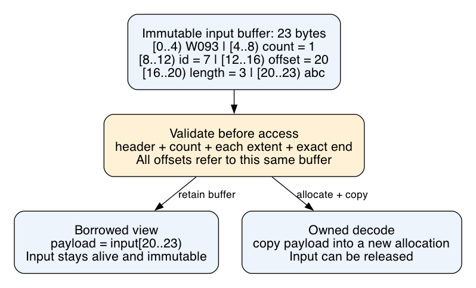

# What this lesson is trying to teach

Topic 093: Wire-format design and zero-copy decoding.

A wire format defines bytes stored or transmitted between programs. Its layout determines validation, allocation, copying and field-access work. A borrowed decoder exposes payloads within the input allocation. It must preserve byte validity and buffer lifetime.

## If you remember only these things

- Define byte order, widths, offset origin, framing and version behavior explicitly.
- Validate lengths and offsets before exposing fields. Bound traversal work and memory use.
- Borrowed fields require backing bytes to stay alive and immutable.
- Measure validation, access, allocation, copying and release for the actual workload.
- Copying a small retained field can release a much larger buffer sooner.

## Running example

A service receives records containing a `u32` ID and binary payload. Some requests read every sixteenth record. Others scan every record repeatedly.

Our format starts with four version bytes, `W093`, and a little-endian `u32` count. Each directory entry contains three little-endian `u32` values: ID, absolute payload offset and payload length. Little-endian stores the least significant byte first. Offsets count bytes from the message start. Payloads follow the directory in record order without gaps. Empty payloads are valid. The final extent must end at the message boundary.



This diagram was rendered and inspected before repository edits. Its message is 23 bytes: header `[0,8)`, entry `[8,20)`, payload `[20,23)`. Relative addressing lets the buffer move without rewriting stored offsets.

## Validation and ownership

Check the header, then require `count <= (length - 8) / 12` before calculating directory size. Require each offset to equal the expected next payload position. Check `offset <= length` and `payload_length <= length - offset` before adding. This prevents arithmetic overflow and out-of-bounds access. Require exact final consumption. The format rejects gaps, overlap, truncation, trailing bytes and unknown versions.

Payloads are binary. Text fields need text validation; authorization remains an application rule. Nested formats need depth, size and traversal-work limits. FlatBuffers provides verifier limits. Cap'n Proto checks pointers during traversal. Sources: [FlatBuffers C++](https://flatbuffers.dev/languages/cpp/), [Cap'n Proto FAQ](https://capnproto.org/faq.html).

A `View<'a>` holds `&'a [u8]` and returns `&'a [u8]` payloads. Safe Rust borrowing keeps the input alive and prevents competing mutation. Externally writable memory needs an ownership or synchronization protocol: mutation after validation can invalidate its proof. The reader still loads metadata and converts byte order. Our implementation uses explicit integer reads and safe slices. Native struct casts add alignment, padding and valid-bit-pattern obligations. See [Rust slices](https://doc.rust-lang.org/std/primitive.slice.html).

A three-byte view can retain a one-megabyte allocation. Copying those three bytes can reduce retained memory when the field outlives the request. Bound retained buffer bytes and retention time across concurrent requests. Fragmented transport input may need assembly into a contiguous buffer. Compression and encryption can require transformation buffers. Name the specific avoided copy in performance claims.

## Alternatives and selection

| Representation | Useful workload | Costs and failure modes |
|---|---|---|
| Fixed directory and borrowed payloads | Selective access; short input lifetime | Directory space, validation, metadata reads, retained input |
| Owned records | Values outlive input, mutate or receive repeated native access | Allocation, copies, destruction, allocation failure |
| Tagged variable-length encoding | Compact small integers; evolving schemas | Field scans, varint decoding, indexing/materialization |
| Established offset format | Generated accessors and direct reads | Format-specific verification, alignment, evolution and lifetime rules |

Protocol Buffers uses field numbers, wire types and varints for several integer types. FlatBuffers supports direct access with compatibility machinery. Cap'n Proto uses aligned words and segments. Our custom-format benchmark does not rank these libraries. Sources: [Protobuf encoding](https://protobuf.dev/programming-guides/encoding/), [FlatBuffers white paper](https://flatbuffers.dev/white_paper/), [Cap'n Proto encoding](https://capnproto.org/encoding.html).

Schema evolution needs stable field identity, defaults and an unknown-field policy. FlatBuffers table fields can be appended, or use explicit IDs, subject to its evolution rules. Changing defaults can change interpretation of existing bytes. Our strict format requires a new version for incompatible changes. See [FlatBuffers evolution](https://flatbuffers.dev/evolution/).

## Runnable example

Save as `one.py`; run `python3 one.py`:

```python
import struct

def decode_one(buf):
    b = memoryview(buf)
    if len(b) < 20 or b[:4] != b"W093":
        raise ValueError("header")
    count, ident, off, size = struct.unpack_from("<IIII", b, 4)
    if count != 1 or off != 20:
        raise ValueError("directory")
    if size != len(b) - off:
        raise ValueError("extent")
    return ident, b[off:]

packet = b"W093" + struct.pack("<IIII", 1, 7, 20, 3) + b"abc"
ident, payload = decode_one(packet)
print(ident, bytes(payload), payload.obj is packet)
```

Expect `7 b'abc' True`. Truncation must raise `ValueError`. `memoryview` borrows; the print's `bytes()` call copies. Retained `demo.py` supports multiple records and prints both success and `rejected: extent`. Both observations were verified before repository edits.

From the repository root:

```sh
python3 topics/093-wire-format/demo.py
cargo test -p topic093-wire-format
cargo build --release -p topic093-wire-format --bin probe
python3 topics/093-wire-format/scripts/run.py target/release/probe /tmp/topic093-fresh-results
```

Use a fresh result directory. The runner compares full records from both Rust decoders with a Python parser. Cases include truncations, mutations, maximal integer bytes, empty payloads and random bytes. Python partitions the suffix by declared lengths using `struct.iter_unpack` for entries. Rust uses explicit reads and direct range checks. Differential testing supplies bounded evidence rather than proof over all messages.

## Experiment and cost model

`borrowed = validation + field access + retained backing memory`

`owned = validation + allocation + copying + native access + destruction`

Both paths validate and sum IDs and every payload byte in selected records. Owned timing includes allocation, copying and destruction. Input generation, startup and file/network I/O are excluded. Input pages are warm. The same input is reused within each process. Retained byte-time, peak RSS and cold allocation remain unmeasured.

Workloads use `(records, payload bytes, selection stride, scans, iterations)`:

- small_sparse: `(128,16,16,1,5000)`
- small_full: `(128,16,1,1,5000)`
- large_sparse: `(128,4096,16,1,300)`
- large_full: `(128,4096,1,1,100)`
- repeated_metadata: `(4096,0,1,32,50)`
- repeated_payload: `(128,64,1,16,300)`

Each host runs eight alternating AB/BA blocks per workload in fresh processes: 96 measured processes and 12 excluded warmups. Linux uses the first allowed CPU. Frequency, thermals, competing load and SMT activity are uncontrolled. Report median and min/max. Declare a winner only when every paired comparison exceeds 5% in the same direction. All pairs within 5% mean an operational tie; other cases are unresolved. This descriptive rule supplies no population confidence interval.

RESULTS.md retains exact source identity, measurements and limits. Choose using measured access patterns, retention needs, schema support and integration costs. Library, network, compressed and cold-storage performance requires separate measurements.
