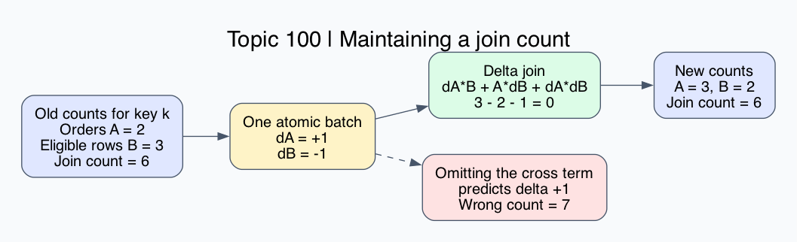

# What this lesson is trying to teach

Incremental computation maintains an answer by processing changes to its inputs.
After every completed update, its answer must equal a fresh computation over the
current inputs. Differential dataflow extends incremental computation to nested
iteration, using logical times that can include iteration coordinates.

## If you remember only these things

- A change has a record, a logical time, and a signed weight. Preserve duplicates and deletions.
- When both join inputs change, include their interaction exactly once.
- Small input changes can cause large output changes. Measure affected work and output size.
- A frontier bounds outstanding logical times. Completion depends on all relevant inputs.
- Retained indexes save repeated work and consume memory. Reader lifetimes control history retention.

## Running example and delta derivation

Maintain the count of pairs in `Orders(customer) JOIN Eligible(customer)`.
Both tables use bag semantics: duplicate rows contribute their full multiplicity.
For customer k, A[k] order rows and B[k] eligibility rows contribute A[k]*B[k].
The query is Q=sum_k A[k]*B[k]. If eligibility means membership, enforce uniqueness
or use an explicit distinct operation. That is a different query contract.

Start with A=2 and B=3, giving six pairs. An atomic batch adds one order and
removes one eligibility row. The new counts are 3 and 2, still giving six pairs.



Expand the product:

```text
(A+dA)(B+dB) - AB = dA*B + A*dB + dA*dB
                  = 1*3 + 2*(-1) + 1*(-1)
                  = 0
```

Computing both input effects against old state and omitting the interaction
predicts a wrong total of seven. A sequential implementation can compute
`dA*B_old + A_new*dB = 3-3 = 0`. It includes the interaction through A_new.
The Rust implementation uses `new_product-old_product` per affected key.

## Differential semantics

An update is `(record,time,weight)`. Positive weights add occurrences; negative
weights retract them. At time t, the collection includes the accumulated weights
from updates at times <=t. Intermediate signed differences are valid; this
example requires nonnegative completed input counts.

Consolidation adds weights for equal records at equivalent times. A +1 and -1
can cancel. Combining across different times must preserve the historical
queries still supported. [Collection semantics](https://github.com/frankmcsherry/blog/blob/master/posts/2020-02-15.md)

For iterative computation, time can be `(input_epoch,iteration)`. With
componentwise ordering, (4,9) and (5,2) are incomparable. A frontier is an antichain,
a set of mutually incomparable timestamps bounding possible outstanding work.
Time t is complete when no frontier element f satisfies f<=t. With frontier
{(4,9),(5,2)}, (5,3) remains open through (5,2), (4,8) is complete, and (4,9)
remains open at equality. A scalar maximum or lexicographic comparison loses
this contract. Held capabilities and delayed inputs can prevent completion.
[Verified progress tracking](https://drops.dagstuhl.de/storage/00lipics/lipics-vol193-itp2021/LIPIcs.ITP.2021.10/LIPIcs.ITP.2021.10.pdf)

A fixed point is a state where another application of the computation leaves
the result unchanged. Differential computation can maintain iterative results
such as graph computations as inputs change. Removing supporting input requires
reconsidering affected results; convergence and affected work depend on the
operator. [Original paper](https://www.microsoft.com/en-us/research/publication/differential-dataflow/)
[Iteration explanation](https://www.frankmcsherry.org/differential/dataflow/2015/04/07/differential.html)

## Arrangements, memory, and completion

An arrangement indexes timestamped updates so operators can reuse keyed state.
Shared arrangements can reduce repeated indexing across queries.
[Arrangements](https://timelydataflow.github.io/differential-dataflow/chapter_5/chapter_5.html)

Logical compaction coalesces timestamp distinctions readers have released.
Physical compaction merges batches. A reader retaining old query times can hold
back logical compaction and retain memory even while ingestion advances.
Advancing that reader's frontier relinquishes historical query capability.
Measure each reader's frontier, retained bytes, update volume and merge work.
[Trace sharing and compaction](https://timelydataflow.github.io/differential-dataflow/chapter_5/chapter_5_3.html)

Our query compresses each input to counts per key. A row-producing join must
produce each changed pair: one new order matching a million rows produces a
million output pairs. Count-only timing cannot establish row-producing latency.

## Runnable example

Save as delta.py and run `python3 delta.py`. Expected output: `6 0 6`.

```python
from collections import Counter

a = Counter({7: 2})
b = Counter({7: 3})
da = Counter({7: 1})
db = Counter({7: -1})
keys = set(da) | set(db)
delta = sum(da[k]*b[k] + a[k]*db[k] + da[k]*db[k] for k in keys)
before = sum(a[k]*b[k] for k in a)
a.update(da)
b.update(db)
assert all(v >= 0 for v in a.values())
assert all(v >= 0 for v in b.values())
after = sum(a[k]*b[k] for k in a)
assert before + delta == after == 6
print(before, delta, after)
```

`Counter.update` adds signed counts. Counter binary addition drops nonpositive
results, so it cannot preserve arbitrary signed deltas.

Run the Rust implementation from the repository root:

```bash
cargo test -p incremental-computation
cargo build --release -p incremental-computation --example probe
cargo run --release -p incremental-computation --example probe -- delta 65536 1 200
cargo run --release -p incremental-computation --example probe -- recompute 65536 1 200
python3 topics/100-incremental-computation/experiment/check.py target/release/examples/probe
python3 topics/100-incremental-computation/experiment/bench.py target/release/examples/probe
```

The first two probes return the same checksum, 78643200, with measured time per
batch. The oracle reports 3000 snapshots and 6000 method comparisons, with
2216 accepted and 784 rejected batches. Three Rust unit tests and one doctest
cover cross terms, duplicate updates, cancellation, invalid-key and count bounds,
consolidation overflow, empty state and totals larger than i64.

The library consolidates repeated keys with checked i64 addition and validates
all new counts before mutation. A rejected batch preserves all state. Counts
are bounded by 1,000,000,000 and totals use i128. On the tested 64-bit platforms,
the total fits even at usize::MAX keys. Consolidation that exceeds i64 is rejected,
including batches whose mathematical sum could fit after further cancellation.

## Alternatives and selection

| Approach | Use when | Costs |
|---|---|---|
| Full recomputation | State is small, queries infrequent, or changes dense | Repeated scan; simple reference implementation |
| Incremental count maintenance | Small frequent batches reuse count state | Consolidation, validation, state maintenance |
| Differential Dataflow | Queries compose incremental operators and iteration | Timestamp state, progress, arrangements, compaction |
| Periodic rebuild plus deltas | Workload and retained state change over time | Rebuild work and consistent generation handoff |

For N keys and K unique changed keys, this implementation's BTreeMap
consolidation costs O(K log K) for unique-key batches. Both methods pay that cost.
Recomputation adds an O(N) scan; delta maintenance adds O(K) arithmetic.
Repeated-key batches also pay for every update record. Dense batches can make
consolidation dominate. A production workload may justify a different batch
representation; these results compare the two methods using the same validation.

## Validation and measurement scope

The independent oracle materializes duplicate rows in SQLite and runs an ordinary
SQL join, checking each completed Rust snapshot. It also checks that rejected
batches preserve state. It uses 3000 deterministic generated batches over 12 keys.
Finite tests provide evidence for this contract; they do not prove arbitrary
program correctness or distributed runtime behavior.

Performance uses eight alternating method pairs per workload, fresh processes,
one warmup per method/cell, identical counts/batches, and checked result checksums.
Linux processes inherit affinity to CPU 0. Timing includes consolidation,
validation, mutation, arithmetic or scanning, allocation and destruction of the
batch map. It excludes process startup, initial count arrays and input generation.
The workload repeatedly moves between (A=2,B=3) and (A=3,B=2) on changed keys.
The total remains constant while both methods execute the changes.

See RESULTS.md for exact-source identities, measurements and variability.
The example models synchronous atomic epochs. Distributed progress, recursive
operators, timestamped traces, recovery, row emission and production-runtime
throughput remain outside the measured scope. Load, clock frequency, thermals,
SMT sibling activity and virtual host placement were uncontrolled.

Failure cases to test in a deployed implementation include omitted or doubled
interaction terms, duplicate loss, invalid completed counts, overflow, partial
batch mutation, premature completion, deletion of recursive support, and readers
retaining history indefinitely.
