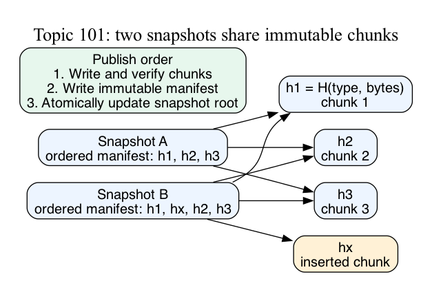

# What this lesson is trying to teach

Content-addressed storage identifies immutable objects by a digest of their encoded
contents. Deduplication reuses objects with the same content. A complete design also
specifies chunk boundaries, publication, collision handling, and reclamation.

Our running example retains two versions of a backup file. Most bytes stay the same.
Both versions must restore exactly while sharing stored chunks.

## If you remember only these things

- Bind object type and format version into the digest input.
- Chunk boundaries determine reuse after edits. Insertions often defeat fixed offsets.
- Store chunks, then the ordered manifest, then publish the snapshot root.
- Collection must protect retained roots, readers, and active writers.
- Measure payload, metadata, ingestion, and restoration separately.

## Object and snapshot identity

Use `SHA-256("chunk-v1\0" || bytes)` for chunk identifiers. A manifest contains an
ordered list of identifiers. Repeated identifiers retain repeated bytes. Sorting or
removing duplicates from this list changes the file. Version the manifest encoding
and define field sizes and byte order. This example encodes a little-endian u64
count followed by 32-byte digests, prefixed with `manifest-v1\0` before hashing.
Production formats can bind lengths and file metadata too.

Venti demonstrated immutable hash-addressed storage and duplicate-block reuse.
Its SHA-1 choice is historical; this example uses SHA-256.
[Primary paper](https://www.usenix.org/legacy/publications/library/proceedings/fast02/quinlan/quinlan_html/index.html).



The rendered and inspected diagram shows two manifests sharing three chunks.
The second manifest adds one chunk. This represents aligned boundaries after the edit.

## Boundary policies

| Policy | Useful workloads | Cost or failure mode |
| --- | --- | --- |
| Whole file | Identical files and small objects | Any edit creates a new whole-file object |
| Fixed 4 KiB | Aligned changes and stable offsets | Insertions shift subsequent boundaries |
| Content-defined | Insertions or deletions within similar files | Per-byte scanning and variable chunk sizes |

Content-defined chunking (CDC) selects cuts using nearby bytes. Its boundary
fingerprint has a separate role from the cryptographic content identifier. Restic
uses content-defined chunks, SHA-256 blob identities, and packs containing multiple
blobs. [Repository design](https://restic.readthedocs.io/en/stable/100_references.html).

Our educational algorithm uses a 64-byte polynomial window, base 257, modulo 2^64:

```text
f = (257*f + incoming - outgoing*257^64) mod 2^64
```

It cuts when the low 12 bits are zero after 2 KiB, or forces a cut at 16 KiB.
The final chunk can be shorter. State resets after every cut. This is a specified
educational algorithm; Rabin and FastCDC use different mechanisms. Uniform low
bits would imply roughly 4096 eligible positions per hit. Bounds, resets, and
input distribution change the actual chunk-size distribution. The implementation
accepts complete byte slices. A streaming interface would need persistent state
and fragmentation-invariance tests.

## Correctness and publication

The store compares bytes on a digest hit and rejects unequal content under the
same key. A forced-collision test verifies this policy. Read verification checks
the digest and object type. The expected root must be trusted: replacing both data
and its expected root can create a different self-consistent snapshot.
Foundation compared hash-based and byte-comparison designs; comparing stored bytes
can add reads. [Primary paper](https://www.usenix.org/legacy/event/usenix08/tech/full_papers/rhea/rhea_html/index.html).

Publication proceeds in three steps:

1. Store and verify every chunk.
2. Store the immutable ordered manifest.
3. Atomically publish the named snapshot root.

A crash before root publication can leave orphans. Early root publication can
expose missing data. Durable implementations must define persistence before each
acknowledgment. Concurrent root writers need a conflict rule, such as compare-and-swap
against the observed root. An uncertain response requires outcome reconciliation.

Collection traces objects from retained roots. Concurrent collection also needs
reader and writer protection: a writer's prepared chunks can otherwise be deleted
before root publication, and a reader can lose chunks behind an older root.
This model uses synchronous single-process operations and quiescent collection.
Physical durability and concurrent reclamation require separate validation.

## Costs and selection

For logical retained bytes L, unique payload U, and metadata M:

```text
payload reuse fraction = 1 - U/L
stored bytes = U + M + index + packing overhead
```

Smaller chunks may reduce U while increasing metadata, index entries, hashing,
and restore lookups. Choose whole-file storage for frequent identical files and
simple metadata; fixed chunks for aligned changes; CDC for insertions and deletions.
Use representative edit patterns and file formats to select a policy.

Compressing each unique chunk preserves cross-snapshot reuse. Randomized encryption
before deduplication generally gives different ciphertext for equal plaintext.
Cross-user reuse exposes equality information and needs an explicit security policy.

## Run the small example

```bash
python3 topics/101-content-addressed-storage/experiment/cas_demo.py
```

Expected output:

```text
logical bytes: 28
unique payload bytes: 16
manifest references: 7
```

The example retains `AAAABBBBCCCC` and `AAAAXXXXBBBBCCCC` with four-byte chunks.
The four-byte insertion preserves alignment. Change it to a one-byte insertion
to expose the fixed-boundary problem. The complete runnable source is in
`experiment/cas_demo.py`; the storage model is in `experiment/cas.py`.

## Run the experiment

From the repository root:

```bash
cargo +1.93.1 build --release -p content-addressed-storage --example chunks
cargo +1.93.1 test -p content-addressed-storage
python3 topics/101-content-addressed-storage/experiment/check.py target/release/examples/chunks
python3 topics/101-content-addressed-storage/experiment/bench.py target/release/examples/chunks
```

The checker expects 171 successful comparisons across 57 inputs, plus collision,
corruption, collection, and type-separation checks. Its Python oracle recomputes
window polynomials directly instead of implementing Rust's rolling recurrence.
Restoration compares complete bytes; unique-payload accounting uses exact-byte sets.
The SHA-256 implementation comes from Python's standard library.

The benchmark retains two versions of a deterministic 1 MiB file. Workloads are
identical copies, a one-byte insertion at offset 12345, a 4 KiB overwrite at offset
12288, and unrelated bytes. Whole-file, fixed, and CDC each run once per permutation
of three modes: six measured fresh Python workers per cell, plus one warmup.
Each worker launches the Rust chunker once per file. This is 72 measured workers
and 12 warmups per host. Linux runs inherit CPU 0 affinity.

Timing starts after data generation. It includes child launches, pipe transfer,
boundary selection, chunk copies, SHA-256, lookup, byte comparison, and manifest
publication. Restore verification and final store destruction are outside timing.
Treat results as this mixed Python/Rust in-memory ingest pipeline. Storage, network,
compression, concurrent writers, peak memory, and restore latency remain unmeasured.
Load, frequency, thermals, and SMT interference are uncontrolled. Local timing can
overlap repository validation.

Retain every sample and report median/min/max. Declare an ingest winner only if it
is at least 5% faster than both alternatives in all six paired blocks; otherwise
report unresolved. Storage counts are exact for these inputs. See RESULTS.md for
measured results and source identities.
