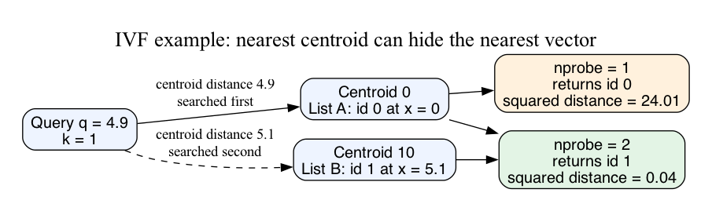

# Approximate nearest-neighbor index mechanics

IVF assigns each vector to its nearest centroid and searches selected lists.
Exact candidate distances can still miss neighbors in omitted lists. Full
probing equals exact search when all IDs are scanned under the same metric.



The immutable Rust crate uses four i32 coordinates, u128 squared distances,
and stable document-ID ties. It sorts selected candidates for clarity. Its
unit tests cover empty populations, ties, extreme coordinates, and 3100
independent absolute-distance ranking comparisons. The doctest demonstrates
one-probe failure and full-probe recovery.

The Python companion uses bounded-heap selection for both exact and IVF search.
Its checks compare centroid assignment with a separate Python expression and
result ranking with an independent SQLite oracle. Run from this topic:

```bash
cargo test -p approximate-neighbors
cd experiment
python3 ann.py demo
python3 experiment.py check
python3 -m unittest test_ann
python3 experiment.py bench > results.json
```

Expected demo: `1 0 2401`, then `2 1 4`. Expected oracle: 5760 comparisons,
seven invalid inputs rejected, and the deliberate one-probe miss detected.
`test_ann.py` checks that the index lists are immutable tuples and that
optimized Python (`-O`, `PYTHONOPTIMIZE`) is refused before any check runs.

[Results and controls](RESULTS.md) describe the Python measurements and limits.
Rust performance is unmeasured. Fixed centroids, exact integers, and immutable
unfiltered data isolate candidate selection. Learning centroids, compression,
HNSW, application relevance, loaded latency, and index mutation require separate
experiments. Exact reranking remains limited by retrieved candidate coverage.

Primary sources:

- [Faiss IVF assignment and probes](https://faiss.ai/cpp_api/struct/structfaiss_1_1IndexIVF.html)
- [Faiss index families](https://github.com/facebookresearch/faiss/wiki/Faiss-indexes)
- [Faiss distance contracts](https://github.com/facebookresearch/faiss/wiki/MetricType-and-distances)
- [Original HNSW paper](https://arxiv.org/abs/1603.09320)
