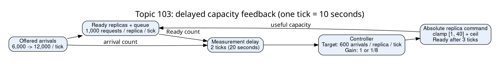

# Feedback-control stability

Delayed measurements can make repeated capacity corrections accumulate before
new replicas become ready. The Rust model compares gain 1, gain 1/8, and direct
arrival feed-forward. Each tick is ten seconds. A ready replica serves 1,000
requests per tick. The target is 600 arrivals per replica per tick.



## State and ordering

Each tick applies the absolute command issued three ticks earlier, admits the
current arrivals, serves up to ready capacity, publishes a measurement, consumes
the measurement from two ticks earlier, then issues a command. Prehistory has
ten ready replicas and 6,000 arrivals per tick. Commands take effect in order.
Scale-up and scale-down share the same fixed delay.

For observed arrival count L, observed ready count R, and retained desired X:

```text
fast:        X = clamp(X + (L/600 - R),     1, 40)
slow:        X = clamp(X + (L/600 - R)/8,   1, 40)
feedforward: X = clamp(L/600,              1, 40)
command = ceil(X)
queue_next = max(0, queue + arrivals - 1000 * ready)
```

Rust stores X in units of 1/4,800 replicas, preserving every fractional update.
Clamping X prevents integral state from accumulating beyond the actuator bounds.
A missing observation holds X. Commands continue through the readiness pipeline.
The simulator models absolute commands and deterministic delays. Kubernetes and
cloud-provider policies require their own transition maps.

## Run

From the repository root, with Rust 1.93.1 and Python 3.9 or later:

```bash
cargo +1.93.1 test -p feedback-control
cargo +1.93.1 build --release -p feedback-control
python3 topics/103-feedback-control/experiment/check.py target/release/feedback-control > results.json
printf '12000 1\n12000 1\n12000 1\n12000 1\n12000 1\n12000 1\n' | target/release/feedback-control feedforward 2 3
```

The last command prints ready replicas, retained desired units, command, and
queue. Expected first row: `10 48000 10 2000`. Expected sixth row:
`20 96000 20 2000`. The checker compares 72,000 complete states with an independent
Python Fraction oracle. The oracle resolves readiness by command timestamps and
computes served work separately. Python optimization mode is refused so checks
remain active.

## Interpretation

For the ideal scalar error recurrence `e[k+1] = e[k] - g*e[k-d]`, all roots of
`z^(d+1) - z^d + g` must lie inside the unit circle. The positive-gain interval
is `0 < g < 2*sin(pi/(4*d+2))`. The sampled ready count reflects a command
issued one actuation delay earlier, so measurement delay m and actuation delay
a give `d = m + a - 1`. For d=0 this is 0<g<2. This experiment has m=2 and a=3,
so d=4 and the upper bound is about 0.347. Gain 1/8 lies inside that interval;
gain 1 lies outside it. This result concerns a continuous-valued linear
recurrence. Replay integer rounding, saturation, missing observations, and
readiness state for an actual autoscaler.

Use lower gain for delay-driven overcorrection. Filtering reduces noise and adds
lag. Tolerance accepts small error. Hysteresis uses distinct switching thresholds.
Stabilization retains recommendation history. Rate limits constrain actuation
speed. Feed-forward depends on offered demand and a valid service-capacity model.

The queue is diagnostic in this example. During saturation recovery, demand-only
control can scale down while old work remains queued. A production queue worker
needs an explicit backlog-drain objective, maximum queue age, and admission policy.

[Results](RESULTS.md) report paired simulation outcomes and limits. The standalone
teaching transcript is retained outside the repository. Primary sources:

- [Astrom and Murray, Feedback Systems](https://fbswiki.org/wiki/index.php/Feedback_Systems:_An_Introduction_for_Scientists_and_Engineers)
- [PID control and saturation](https://fbswiki.org/wiki/index.php/PID_Control)
- [Kubernetes HPA algorithm and stabilization](https://kubernetes.io/docs/concepts/workloads/autoscaling/horizontal-pod-autoscale/)
- [EC2 target tracking metrics and warmup](https://docs.aws.amazon.com/autoscaling/ec2/userguide/as-scaling-target-tracking.html)
