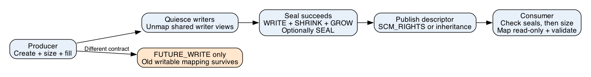

# What this lesson is trying to teach

Topic 107: publish a shared buffer whose bytes and length remain fixed after
another process receives its descriptor.

## If you remember only these things

- Seal the completed object before publishing its descriptor.
- Require `F_SEAL_WRITE | F_SEAL_SHRINK | F_SEAL_GROW` for fixed bytes and length.
- `F_SEAL_FUTURE_WRITE` permits writes through existing shared writable mappings.
- The consumer checks seals before trusting the size or parsing data.
- Immutability preserves bytes. Format validation and producer authentication remain separate requirements.

## Problem and running example

A producer builds a routing table for several worker processes. Each worker
checks the header, validates offsets, and reads entries directly from a shared
mapping. A concurrent producer could change an offset after validation or
truncate the file. Access to a page beyond the new end can raise `SIGBUS`, a
signal for an invalid backing-memory access.

Linux `memfd_create()` creates an anonymous memory-backed file. A seal is a
kernel-enforced restriction on the object, shared by every descriptor referring
to it. Create with `MFD_ALLOW_SEALING` to permit the restrictions and
`MFD_CLOEXEC` to close the descriptor across exec. The debug name does not provide
an identity or authentication mechanism. [memfd_create](https://man7.org/linux/man-pages/man2/memfd_create.2.html)

## Publication order



The diagram was rendered with Graphviz and visually inspected before teaching.

1. Create, size, and fill the routing table while the producer owns the write phase.
2. Join writers and unmap shared writable views across all participating processes.
3. Add WRITE, SHRINK, and GROW seals. Publish only after success.
4. Transfer the descriptor through a Unix socket, or create a child that inherits it.
5. The receiver checks required seal bits, then obtains the stable size with `fstat`.
6. Enforce a size limit, map read-only, and validate schema, counts, and all ranges.

For a range, check `offset <= length` and `count <= length - offset` before
forming its end. The retained Rust policy example implements this check.

`F_SEAL_WRITE` rejects file writes and new shared writable mappings. It permits
resize unless SHRINK/GROW also apply. `F_SEAL_SEAL` locks further seal additions;
add it when the policy is final. Seals are irreversible, so byte immutability
already holds with the required three bits. Adding WRITE while a shared writer
mapping exists fails with `EBUSY`. [Seal API](https://man7.org/linux/man-pages/man2/F_ADD_SEALS.2const.html)

## Runnable example

Save the following as `example.py`. Run `python3 example.py` on Linux with Python
3.8 or later. It performs both roles in one process; the full checker below
also publishes across processes.

```python
"""Run with Python 3.8+ on Linux."""
import errno
import fcntl
import mmap
import os

fd = os.memfd_create("routing-table", os.MFD_CLOEXEC | os.MFD_ALLOW_SEALING)
payload = b"route=worker-7\n"
os.ftruncate(fd, len(payload))
with mmap.mmap(fd, len(payload), access=mmap.ACCESS_WRITE) as writer:
    writer[:] = payload
required = fcntl.F_SEAL_WRITE | fcntl.F_SEAL_SHRINK | fcntl.F_SEAL_GROW
fcntl.fcntl(fd, fcntl.F_ADD_SEALS, required | fcntl.F_SEAL_SEAL)
assert fcntl.fcntl(fd, fcntl.F_GET_SEALS) & required == required
length = os.fstat(fd).st_size
assert 0 < length <= 4096
with mmap.mmap(fd, length, access=mmap.ACCESS_READ) as reader:
    assert reader[:] == payload
    print(reader[:].decode(), end="")
try:
    os.ftruncate(fd, 0)
except OSError as error:
    assert error.errno == errno.EPERM
    print("shrink blocked")
else:
    raise AssertionError("shrink unexpectedly succeeded")
os.close(fd)
```

Expected output:

```text
route=worker-7
shrink blocked
```

Update the routing table by creating and sealing a new object. Distribute its
descriptor and retire the old version after readers release their mappings.
Slow readers can retain several generations and increase memory use.

## Failure modes

`F_SEAL_FUTURE_WRITE` preserves existing shared writable mappings. Use that
contract for an authorized ongoing writer with synchronized readers and version
validation. A consumer that parses once and reuses fields indefinitely requires
stable bytes. The kernel selftests exercise these mapping restrictions.
[Kernel selftests](https://github.com/torvalds/linux/blob/v6.12/tools/testing/selftests/memfd/memfd_test.c)

Sealing incomplete initialization preserves incomplete contents. Join writers
before sealing. On sealing failure, retain or discard the candidate according
to a bounded retry policy and withhold publication. Writable mappings in other
processes still matter after local unmapping. Pinned references can also block
sealing. [Kernel implementation](https://github.com/torvalds/linux/blob/v6.12/mm/memfd.c)

A read-only mapping restricts that view; another descriptor can modify an
unsealed backing file. Private writable mappings use copy-on-write and change
their own bytes. Closing a descriptor leaves an existing mapping valid.
[mmap](https://man7.org/linux/man-pages/man2/mmap.2.html)

A sealed table can still contain invalid offsets or unauthorized routes.
Authenticate the sender and validate the representation after verifying seals.
This contract assumes the kernel and local process security boundary are trusted.

## Alternatives and costs

| Design | Selection criterion | Costs and obligations |
|---|---|---|
| Sealed memfd | Multiple local readers of immutable versions | Linux dependency, mapping setup, descriptor transfer, retained old versions |
| Private owned copy | Small payloads or portable interfaces | Copy and allocation per consumer; validate the completed private copy |
| Mutable shared mapping | Frequent in-place updates | Synchronization, version checks, writer authority, crash recovery |
| Versioned regular file | Versions survive restart | Durable filesystem publication and protection against later modification |

For the routing table, sealed versions allow validation once and repeated reads.
Whether this saves time depends on size, number of readers, and reuse. Mapping
setup and faults cost work. This lesson measures correctness, with no speed claim.

## Reproduce the tests

From the repository root:

```sh
cargo +1.93.1 test -p memfd-sealing
python3 topics/107-memfd-sealing/example.py
python3 topics/107-memfd-sealing/check.py > memfd-results.json
```

The native checker requires Linux. macOS reports SKIP; the pure Rust policy
checks run on both systems. Run under an external timeout in unattended jobs
because a failed child handshake can otherwise leave its parent waiting.

The checker requires a kernel with `F_SEAL_FUTURE_WRITE`, which mainline Linux
provides from 5.1, and Python 3.8 or later with assertions enabled, the
`python3` default. It validates with `assert`. A run under `python3 -O` or
`PYTHONOPTIMIZE=1` exits with status 1 before it prints the `PASS` record.

The checker creates a fresh object for each of 16 seal combinations and five
operations: overwrite, shrink, grow, shared write mapping, and private write
mapping. A declarative operation policy predicts success or EPERM. A separate
bytes object predicts the complete resulting payload and length.

A pipe-ordered child retains a writer mapping after its parent unmaps. WRITE
sealing must fail with EBUSY; FUTURE_WRITE allows that child to change the first
byte. After the child unmaps and exits, WRITE sealing succeeds. Six separately
published payload sizes test every received byte against an algebraic oracle.
Producer data uses a recurrence; receiver expected data uses a closed formula.

These finite checks exercise selected syscall contracts. They do not establish
arbitrary-schedule correctness, throughput, durability, DMA behavior, socket
SCM_RIGHTS transfer, or every kernel and security configuration. See RESULTS.md
for measured hosts, exact source identity, and validation results.
