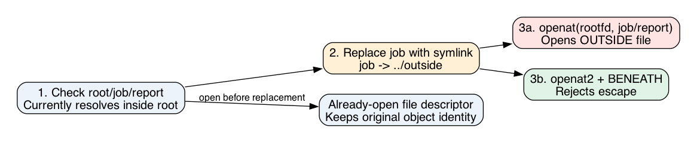

# What this lesson is trying to teach

Topic 110: filesystem path-resolution races. Enforce the path policy during the
operation that acquires the file. A separate check and open can observe different
namespace states.

## If you remember only these things

- A checked pathname can refer to a different object when opened.
- A directory descriptor fixes the lookup start; plain openat still allows escape.
- Apply openat2 resolution flags during acquisition.
- Inspect and use the returned descriptor throughout the operation.
- Containment, identity, authorization and stable contents are separate requirements.

## Running example

A report server accepts `job/report` under a trusted `root` directory. Another
process can rename entries below root. A pathname is a sequence of directory
entries. A symbolic link supplies another pathname during resolution. A file
descriptor refers to an opened object and remains attached across name replacement.
See [path resolution](https://man7.org/linux/man-pages/man7/path_resolution.7.html)
and [open](https://man7.org/linux/man-pages/man2/open.2.html).

The server resolves `root/job/report`, checks containment, then opens it. Between
those actions, another process renames job and installs `job -> ../outside`.
The open reaches `outside/report`. This is a time-of-check/time-of-use race:
the check and action observe different namespace states.



`realpath` or `canonicalize` returns a resolved name. Opening that name starts
another lookup. A component-aware prefix check solves string parsing mistakes
such as `/reports-other` matching `/reports`; namespace replacement remains possible.

## Deterministic reproducer

Save the following as `demo.py` and run `python3 demo.py` on macOS or Linux.
The replacement occurs at the vulnerable point, so timing assumptions are unnecessary.
Expected output is `reopened: OUTSIDE` followed by `held: INSIDE`.

```python
import os
from pathlib import Path
from tempfile import TemporaryDirectory

with TemporaryDirectory() as tmp:
    base = Path(tmp)
    root, outside = base / "root", base / "outside"
    (root / "job").mkdir(parents=True)
    outside.mkdir()
    (root / "job" / "report").write_text("INSIDE\n")
    (outside / "report").write_text("OUTSIDE\n")
    candidate = root / "job" / "report"
    checked = candidate.resolve()
    assert root.resolve() in checked.parents
    rootfd = os.open(root, os.O_RDONLY | os.O_DIRECTORY)
    held = os.open("job/report", os.O_RDONLY, dir_fd=rootfd)
    try:
        (root / "job").rename(root / "saved")
        (root / "job").symlink_to("../outside")
        reopened = os.open(
            "job/report", os.O_RDONLY | os.O_NOFOLLOW, dir_fd=rootfd
        )
        try:
            bad = os.read(reopened, 100).decode().strip()
            good = os.read(held, 100).decode().strip()
            assert (bad, good) == ("OUTSIDE", "INSIDE")
            print("reopened:", bad)
            print("held:", good)
        finally:
            os.close(reopened)
    finally:
        os.close(held)
        os.close(rootfd)
```

The intermediate component job is a symlink. `O_NOFOLLOW` checks only the final
component. The held descriptor continues to identify the original file. Rootfd
fixes the starting directory but plain openat follows intermediate links.
These guarantees are specified in [open(2)](https://man7.org/linux/man-pages/man2/open.2.html).

## Select the resolution policy

| Requirement | Choice | Cost or constraint |
|---|---|---|
| Reject escape | RESOLVE_BENEATH | Rejects absolute paths and absolute link targets |
| Resolve absolute names inside rootfd | RESOLVE_IN_ROOT | Reinterprets absolute names and clamps root-level .. |
| Reject every symlink | RESOLVE_NO_SYMLINKS | Rejects legitimate symlink layouts |
| Reject kernel magic links | RESOLVE_NO_MAGICLINKS | Protects paths such as /proc/self/fd/N |
| Reject mount traversal | RESOLVE_NO_XDEV | Also rejects bind mounts |

Choose either BENEATH or IN_ROOT. NO_SYMLINKS implies NO_MAGICLINKS. For this
server, relative names and ordinary directories permit BENEATH | NO_SYMLINKS.
See the [openat2 contract](https://man7.org/linux/man-pages/man2/openat2.2.html).

## Runnable Linux implementation

Save this as `open_report.c`. ROOT comes from trusted configuration. The program
checks the returned object type. O_NONBLOCK avoids waiting for a FIFO before that
check. Device opens can have effects; a production service also needs a trusted
file-type population or a device-access policy.

```c
#define _GNU_SOURCE
#include <fcntl.h>
#include <linux/openat2.h>
#include <stdio.h>
#include <sys/stat.h>
#include <sys/syscall.h>
#include <unistd.h>

/* Exposed for the identity-oracle harness. Errors retain errno. */
int open_policy(int root, const char *path, unsigned long long resolve) {
    struct open_how how = {
        .flags = O_RDONLY | O_CLOEXEC | O_NONBLOCK | O_NOCTTY,
        .resolve = resolve
    };
    return syscall(SYS_openat2, root, path, &how, sizeof how);
}

#ifndef LIBRARY_ONLY
int main(int argc, char **argv) {
    if (argc != 3) {
        fprintf(stderr, "usage: %s ROOT RELATIVE_PATH\n", argv[0]);
        return 2;
    }
    /* ROOT comes from trusted configuration. */
    int root = open(argv[1], O_PATH | O_DIRECTORY | O_CLOEXEC);
    if (root < 0) { perror("root"); return 1; }
    int fd = open_policy(root, argv[2], RESOLVE_BENEATH | RESOLVE_NO_SYMLINKS);
    close(root);
    if (fd < 0) { perror("openat2"); return 1; }
    struct stat st;
    if (fstat(fd, &st) || !S_ISREG(st.st_mode)) {
        fprintf(stderr, "expected regular file\n");
        close(fd);
        return 1;
    }
    printf("opened regular file, size=%lld\n", (long long)st.st_size);
    close(fd);
    return 0;
}
#endif
```

Run these commands in a fresh disposable directory:

```sh
cc -std=c11 -O2 -Wall -Wextra -Werror open_report.c -o open_report
mkdir -p root/job outside
printf 'INSIDE\n' > root/job/report
printf 'OUTSIDE\n' > outside/report
./open_report root job/report
mv root/job root/saved
ln -s ../outside root/job
./open_report root job/report
```

Expect a successful regular-file open followed by a symlink rejection.
The structure initializer leaves unspecified fields zero.

## Failure behavior

EXDEV signals an escape or forbidden mount crossing. ELOOP can signal a forbidden
symlink. EAGAIN can signal a concurrent rename that prevented safe containment.
Retry EAGAIN with a finite budget and the same security flags. Unsupported calls
and invalid policies fail the request. See [openat2 errors](https://man7.org/linux/man-pages/man2/openat2.2.html).

Linux detects relevant concurrent rename activity during constrained parent
traversal. Application-side normalization cannot control that entire operation.
The [kernel lookup documentation](https://docs.kernel.org/filesystems/path-lookup.html)
explains the rename checks and directory-entry lifetime rules.

## Alternatives, costs and scope

A pre-opened directory handle survives changes to its configuration pathname.
A pre-opened file handle preserves the acquired object. A component-by-component
openat traversal can reject links and parent components, but concurrent directory
relocation requires a carefully specified containment contract. A maintained
capability API with documented platform guarantees can help portable code.
More component opens add syscalls and descriptor-lifetime management. This lesson
measures correctness only; it reports no performance ranking.

Containment constrains lookup. A writer can still modify the opened file.
A hard link inside root can name an inode also reachable elsewhere. Apply
object authorization, control tree population, and use immutable publication or
a snapshot protocol when content consistency matters. A directory can also be
renamed after acquisition, so a descriptor does not promise permanent namespace
membership. These distinctions follow from the kernel object/reference model.

## Validation and commands

From the repository root:

```sh
sh topics/110-path-resolution/check.sh
cargo +1.93.1 test -p topic110-path-resolution
```

The Rust function checks request grammar only. The Python reproducer confirms
the check/open gap. The Linux matrix obtains device/inode identities from held
fixture descriptors before calling the C wrapper. Explicit expected identities
and errno values form an independent oracle rather than another path resolver.
It covers ordinary and absolute names, internal and escaping links, magic links,
parent components, mount crossing, hard links, FIFO type checks and root renaming.
A concurrent replacement loop checks every successful open against the safe inode.
This samples schedules; it does not prove arbitrary kernel interleavings.

See RESULTS.md for executed host results and exact committed-source identity.
