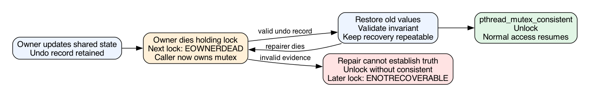

# What this lesson is trying to teach

A robust mutex lets a surviving process acquire a lock whose owner died. The
application must decide whether the protected data can be repaired safely.

## If you remember only these things

- `EOWNERDEAD` means the caller acquired the mutex and must inspect protected state.
- Repair and validate data before calling `pthread_mutex_consistent()`.
- Retain trustworthy recovery evidence until restoration finishes. Recovery must tolerate another crash.
- Unlocking an inconsistent mutex makes later acquisitions fail with `ENOTRECOVERABLE`.
- Power-loss recovery requires a persistence protocol beyond robust mutex ownership.

## The partial update

Two balances start at `(60, 40)`. A transfer of 10 must preserve their sum of
100. The owner locks the mutex, writes the first balance as 50, and dies before
writing the second as 50. The surviving process encounters `(50, 40)`.

A stalled mutex can remain locked after owner death. With `PTHREAD_MUTEX_ROBUST`,
the next lock holder receives `EOWNERDEAD`. That return value grants ownership
and requires recovery. Check pthread return values directly; they return error
numbers rather than setting `errno`.

For shared mappings across processes, also configure `PTHREAD_PROCESS_SHARED`.
Initialize once before participants start. All users must follow the same lock,
ABI, initialization and object-lifetime contract.

## Ordered undo protocol

While holding the mutex, save the old balances, publish an active marker, update
both balances, clear the marker to commit, and unlock. An owner dying with an
active marker leaves an operation that recovery rolls back. Death after clearing
the marker preserves the completed transfer.

Recovery restores both old balances by assignment. It validates them, then clears
the marker. Repeating these assignments gives the same result if the repairer dies.
Keep the undo record valid until restoration completes. A caller with a lost
response still needs an operation identifier or another retry protocol to learn
whether its request committed.



The native example uses lock-free sequentially consistent atomic integers for
shared fields. This establishes ordered stores at the injected process-death
boundaries on the tested platforms. It assumes compatible process ABIs, valid
initial state, checked transfer amounts, and participants following the protocol.
`a + b == 100` alone cannot detect arbitrary corruption: `(70, 30)` also passes.
Recovery evidence must identify the authoritative state.

`pthread_mutex_consistent()` records the application's assertion that state is
repaired. It performs no balance validation. Call it after restoration while
holding the mutex. The essential acquisition path is:

```c
int rc = pthread_mutex_lock(&shared->mutex);
if (rc == EOWNERDEAD) {
    if (!repair_and_validate(shared)) {
        pthread_mutex_unlock(&shared->mutex);
        return ENOTRECOVERABLE;
    }
    rc = pthread_mutex_consistent(&shared->mutex);
    if (rc != 0)
        abort();
} else if (rc != 0) {
    return rc;
}
return pthread_mutex_unlock(&shared->mutex);
```

This fragment assumes application-specific `shared` and `repair_and_validate`.
The complete program is [native.c](native.c).

If a repairer dies before declaring consistency, the next owner receives
`EOWNERDEAD` again. Death while still holding the mutex after consistency also
requires the next owner to inspect data. If repair cannot establish a valid state,
unlock without consistency and refuse normal access. Later locks fail with
`ENOTRECOVERABLE`. Stop all users before destroying or replacing the old region.
Reinitializing a mutex while other users retain access violates its lifetime contract.

Linux maintains a per-thread robust-futex list. On exit the kernel marks locks
owned by the dying thread and wakes waiters. Application code defines recovery;
use pthread APIs for mutex internals. A hung live owner needs separate supervision.

## Run the examples

From the repository root:

```sh
cargo +1.93.1 test -p topic111-robust-mutex
cd topics/111-robust-mutex
python3 protocol.py
# Linux:
cc -std=c11 -O2 -Wall -Wextra -Werror -pthread native.c -o /tmp/topic111-native
timeout 30s /tmp/topic111-native > /tmp/topic111-native.csv
python3 oracle.py /tmp/topic111-native.csv
python3 -m unittest test_oracle.py
```

The portable example prints `(60, 40)` for crash points 0 through 4 and `(50, 50)`
for point 5. Its final line reports six crash points and repeated recovery.
The native oracle expects 360 repaired cases, 12 poisoned cases and 12 premature
consistency cases. It requires the exact 384 scenario keys that `native.c` emits
and exits under `python3 -O` or `PYTHONOPTIMIZE`, which strip its assertions.
`test_oracle.py` checks those refusals against the retained CSV files.
Premature consistency is an intentional negative control:
a subsequent normal acquisition succeeds while the balances still violate the invariant.

Native cases use four initial balances, three positive transfer sizes, six writer
crash points and five repair modes: direct recovery, three restoration boundaries,
and death after consistency. When a restoration boundary is inapplicable because
the record is inactive, the repairer completes repair and dies holding the mutex.
Each child exits through `_exit` while owning the lock; parent `waitpid` removes
sleep-based scheduling assumptions. The test checks every acquisition return code.

The independent Python oracle derives expected balances from the serial operation's
commit point, without replaying the undo implementation. Rust tests exhaust all
101 initial balances and all valid transfer sizes across six crash boundaries,
then repeat recovery. These finite tests cover the declared state machine.

## Selection and costs

| Approach | Use when | Cost or failure mode |
|---|---|---|
| Robust mutex and undo record | Survivors can reconstruct mutable shared state | Bookkeeping, serialized repair and careful error handling |
| Rebuild shared state | An authority can reconstruct disposable data | Service interruption, rebuild work and coordinated replacement |
| Immutable versions and atomic publication | Readers can retain complete published versions | Extra memory, publication ordering and reclamation |
| Database or durable log | State must survive machine failure or coordinate durable effects | Storage, logging and transaction costs |

This experiment measures correctness outcomes. Throughput, recovery latency,
machine crashes, arbitrary memory corruption, actual SIGKILL delivery, and
arbitrary concurrent schedules remain unmeasured. `_exit` exercises kernel
owner-death handling at deterministic boundaries. All native runs are single-threaded
parents with sequential child processes; production fork rules require separate review.

## Primary sources

- [Robust mutex attributes and owner-death returns](https://man7.org/linux/man-pages/man3/pthread_mutexattr_setrobust.3.html)
- [Application responsibility before declaring consistency](https://man7.org/linux/man-pages/man3/pthread_mutex_consistent.3.html)
- [Kernel robust-futex mechanism](https://docs.kernel.org/locking/robust-futexes.html)

See [RESULTS.md](RESULTS.md) for tested revisions, counts, hosts and limitations.
