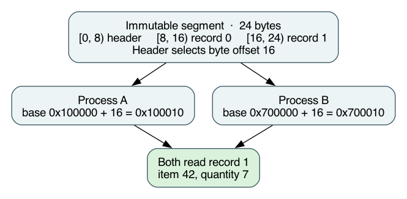

# What this lesson is trying to teach

Two processes can read the same inventory file at different virtual addresses. Store the selected record's byte offset from the start of the file. Each reader resolves that offset using its own mapping base, the local address of byte zero. The segment in this example is the complete mapped file. [Boost.Interprocess](https://www.boost.org/doc/libs/latest/doc/html/interprocess/offset_ptr.html)

## If you remember only these things

- Specify the origin, width, units, and valid values of each offset.
- Validate both the whole record and its start position. An in-bounds read can combine fields from different records.
- Keep the mapping and its contents stable through the last read. Reusing a slot can change which item a valid offset denotes.
- Define field widths and byte order. Decoding bytes avoids depending on a compiler's struct layout or a CPU's tolerance for unaligned loads. [FlatBuffers internals](https://flatbuffers.dev/internals/)

## Resolve the selected inventory record

The eight-byte header starts with the four bytes `INV1`. This identifies the format and version. The next four encode an unsigned little-endian byte offset from the start of the segment. Each record holds two little-endian 32-bit unsigned integers, item ID and quantity. The file must contain a header and at least one whole record. This format requires a selection.



The first record, at offset 8, contains (11, 3). The second, at offset 16, contains (42, 7). A reader with base 0x100000 finds the second record at 0x100010. A reader with base 0x700000 finds it at 0x700010. Both addresses in the diagram are illustrative. Saving one reader's absolute address in the file would tie other readers to its virtual address layout. [Boost.Interprocess](https://www.boost.org/doc/libs/latest/doc/html/interprocess/offset_ptr.html)

Offset 12 is the instructive failure. It is four-byte aligned and leaves room for eight bytes. Reading there returns (3, 42), a plausible record assembled from two different items. First check the header, minimum length, and whole-record count. Require `8 <= offset <= length - 8` and `(offset - 8) % 8 == 0`. The upper bound avoids overflow in fixed-width addition. Offset 24 points just past the file.

This alignment check measures the position in the file. To construct a native typed reference, the effective address must also meet the type's alignment, lifetime, representation, and aliasing requirements. The example decodes scalar bytes. It works even when the containing byte slice begins at an odd address.

## Run it

From this directory, run the following command on macOS or Linux with Python 3.

```sh
python3 inventory.py
```

The program decodes five selections. It then maps one temporary file read-only, forks, and opens a second mapping in the child while the inherited one is still live. Those two mappings must occupy distinct addresses in the child. The child reads the same selected item as the parent. The test relies on the program's sole writer finishing before either mapping is created.

```text
8 (11, 3)
16 (42, 7)
12 invalid record offset
24 invalid record offset
4294967295 invalid record offset
child read (42, 7) from a distinct mapping
```

The decoder is short enough to inspect in full.

```python
def selected(data):
    size = len(data)
    if size < 16 or size % 8 or data[:4] != b"INV1":
        raise ValueError("invalid inventory layout")
    offset, = struct.unpack_from("<I", data, 4)
    if offset < 8 or offset > size - 8 or (offset - 8) % 8:
        raise ValueError("invalid record offset")
    return struct.unpack_from("<II", data, offset)
```

The module imports Python's `struct` library. From the repository root, run `cargo test -p topic112-relocatable-inventory`. Its independent oracle records each record's byte position while constructing a segment. It compares the decoder's answer with the item written at that position across 6,048 combinations of count, trailing length, and offset. Separate tests cover short headers and a wrong version.

## Choose the representation

| Representation | When it fits | Cost or failure to handle |
|---|---|---|
| Segment-relative offset | One segment, possibly with several sections or variable-size records | Validate the target's section, type, and extent. A 32-bit field can encode starts through byte 4,294,967,295. |
| Record index | A dense fixed-width array such as this inventory | Check the index against the count, then compute its position with checked arithmetic. Reordering records changes their indices. |
| Field-relative offset | Links whose field and target relocate together | Moving just the field changes the required displacement. Boost measures from the pointer object and reserves displacement 1 for null. [Boost.Interprocess](https://www.boost.org/doc/libs/latest/doc/html/interprocess/offset_ptr.html) |
| Private decoded copy | Small snapshots or readers that must outlive their mapping | Each reader pays for copying and storage. Keep the source consistent through the copy. |

For this inventory, an index gives the simplest field contract. A byte offset is useful when sections have different record sizes. If a long-lived handle must survive record deletion and reuse, include and validate the segment identity and a generation identifying the record incarnation.

## Publish a stable generation

Finish writing the complete inventory before handing it to readers. Preserve that generation until the last reader releases it. A read-only mapping restricts its holder. Another process with write authority can still change or truncate the backing file. On Linux a producer can seal an eligible file against writing, shrinking, and growth after finishing initialization and removing shared writable mappings. The receiver can verify the seals before trusting the size. [Linux file seals](https://man7.org/linux/man-pages/man2/F_GET_SEALS.2const.html)

If writers update in place, hold a process-shared lock from validation through use. Require every writer to follow the same protocol. An unlocked reader retaining a pointer also needs a rule preventing unmap, deletion, or slot reuse. These are independent obligations. The offset identifies a location, while the publication and lifetime rules preserve what a reader can safely observe there.
