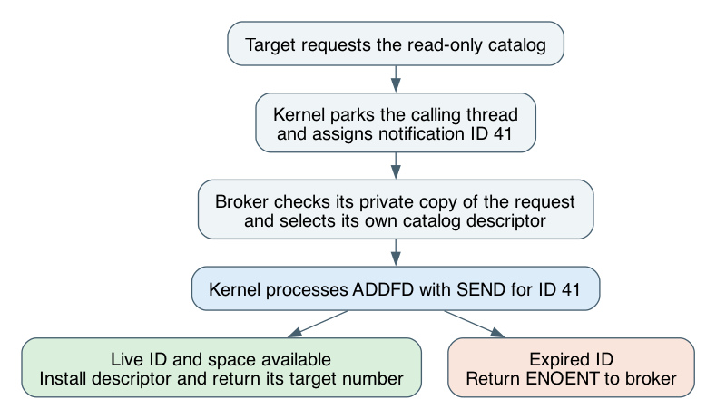

# What this lesson is trying to teach

A seccomp notification parks the thread that made a syscall. Other threads can
still change memory referenced by its arguments. A file broker needs two
guarantees. It must act on the request it validated and deliver the result to
the call that is still waiting.

## If you remember only these things

- The notification contains argument words. A pathname argument holds an address.
- Copy bounded input into broker-owned memory. Validate and use that same copy.
- A notification ID names one pending call. Checking its validity gives a point-in-time answer.
- Use `SECCOMP_IOCTL_NOTIF_ADDFD` with `SECCOMP_ADDFD_FLAG_SEND` to install
  the broker's file and return the target's descriptor number atomically.



## A read-only catalog

A worker requests the name `catalog` with read-only access and close-on-exec.
Its broker already holds the approved file open. A seccomp filter selects the
syscall for user notification. The kernel supplies an ID, the target thread ID,
the architecture, the syscall number and its numeric arguments.

The broker checks the operation and flags. It copies exactly eight bytes from
the worker, including the terminator. A failed or short read takes the denial
path. Copies can observe a concurrent write partway through. Every accepted
sequence still means the same thing here: the seven bytes of `catalog` and a
zero select one broker-owned file. The broker uses that descriptor for delivery.
The kernel never has to resolve the worker's pathname.

A time-of-check/time-of-use race occurs when a decision reads one value and the
operation can consume another. Returning `CONTINUE` delegates execution of the
original call to the kernel, which can read the worker's memory again. Use
emulation when a decision depends on copied bytes. A general `openat` emulator
must also account for directory handles, credentials, flags and mount namespaces.
The example defines only a private virtual catalog request.

## Descriptor delivery

A descriptor is an index in a process's descriptor table. Returning a broker
index as an integer cannot convey the file. Linux 5.14 added the SEND flag
to ADDFD. The kernel duplicates the source file into the target and completes
the call with the allocated target index. Set `newfd_flags = O_CLOEXEC` for
close-on-exec. The aliases share an open file description and its offset.
The worker uses `pread` with an explicit offset.

A signal or exit can cancel a notification. ID_VALID checks whether the
notification is live at the time of the ioctl. Delivery checks again. Discard
an expired request on ENOENT and release request-owned descriptors. A restarted
syscall can receive a fresh ID. If allocation fails while the call is live,
the broker can send an error reply. A separate add and reply can leave an
installed descriptor after a failed reply. Atomic delivery covers those two
actions. File creation or modification before delivery has its own effects.

## Choose an interface

| Requirement | Interface | Cost |
|---|---|---|
| A worker always needs one file | Pass the read-only file at startup | Access begins immediately and consumes a descriptor. |
| You own both programs and need access on demand | Explicit request and SCM_RIGHTS over a Unix socket | Define a protocol and manage descriptor lifetime. |
| A legacy program needs a narrow virtual operation | Seccomp notification with ADDFD and SEND | Kernel feature dependency, extra round trip and cancellation handling. |
| Only syscall numbers and scalar values matter | Decide in a seccomp filter | Filter logic cannot inspect bytes through pointers. |

## Run the examples

From this topic directory:

```sh
python3 example.py
cargo test -p topic113-seccomp-broker
```

Python prints `read-only catalog`, `denied`, then `expired`. The Rust test
checks every one-byte substitution, short copies and an overlong input.

On native little-endian x86-64 or AArch64 Linux with user notification,
ADDFD with SEND, and permission for a parent to read its child:

```sh
cc -std=c11 -O2 -Wall -Wextra -Werror broker.c -o /tmp/topic113-broker
/tmp/topic113-broker
```

Expect `2 denials, 1 verified catalog descriptor, completed ID rejected`.
The cooperative child closes its inherited listener and catalog. It requests
an unknown name, write access, then the allowed read. It checks the received
file against the original device and inode, known bytes, access mode and
close-on-exec flag. The supervisor checks ENOENT for the completed ID. A
fixed architecture and reserved directory argument isolate the fixture's
calls. Unexpected kernel results stop the test.

## Sources

- [Linux kernel seccomp filter documentation](https://docs.kernel.org/userspace-api/seccomp_filter.html)
- [Linux seccomp_unotify(2), notification lifetime and descriptor delivery](https://man7.org/linux/man-pages/man2/seccomp_unotify.2.html)
- [Linux dup(2), shared open file descriptions](https://man7.org/linux/man-pages/man2/dup.2.html)
- [Linux unix(7), SCM_RIGHTS](https://man7.org/linux/man-pages/man7/unix.7.html)
