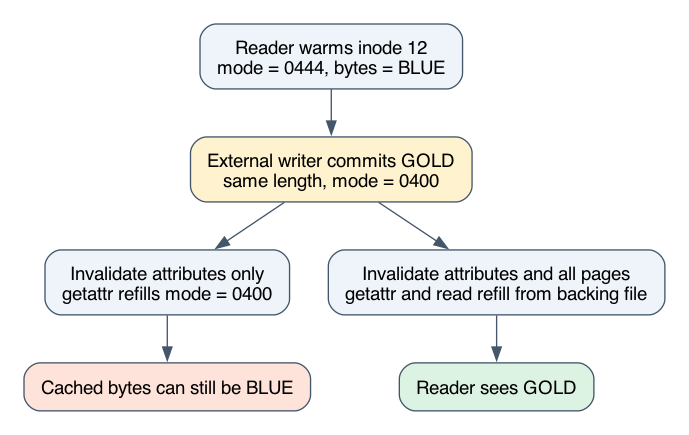

# What this lesson is trying to teach

A read through a FUSE mount can return bytes that an external writer has
already replaced. A FUSE daemon serves filesystem operations in userspace.
Linux can answer a request from its own cache before the daemon sees it.

## If you remember only these things

- Track the cached name, attributes and pages separately.
- Refreshing metadata alone can leave old bytes on an open descriptor.
- Invalidate a parent/name mapping when an external writer replaces a directory entry.
- Define the visibility point for each mount and handle missed notifications.



## Follow one descriptor

Open `palette`, which maps to inode 12. An inode identifies a file within
this mount. Read the four bytes `BLUE` and check its permissions, `0444`.
Keep the descriptor open. An external writer updates the backing file to
`GOLD` and changes its permissions to `0400`. Each read below begins after
both changes are visible in the backing store.

| Cached answer | Key | What this update requires |
|---|---|---|
| Directory entry, including a cached absence | Parent inode and name | Keep the mapping to inode 12. |
| Attributes, including mode and size | Inode | Expire the old mode. Equal lengths conceal the overwrite from a size check. |
| Clean file data | Inode and page offset | Evict the page covering bytes 0 through 3. |

With a warm page, an attribute-only notification can produce `0400 BLUE`.
Calling `fuse_lowlevel_notify_inval_inode(se, 12, 0, 0)` expires attributes
and invalidates data from offset zero to the end. After the daemon returns
success, the reader can obtain `0400 GOLD`. A negative offset selects
attributes only. Use a range when the writer knows exactly which extent
changed. Whole-inode invalidation costs more refills on a large hot file.

If an external writer replaces the name with a different inode, invalidate
the entry by parent and name. A fresh lookup can find the replacement while
an open descriptor continues to identify the old inode. Also invalidate cached
absence on external creation. Send entry notifications outside related request
callbacks and locks those operations may need.

## Choose the read contract

Long-lived caches suit repeated reads when every mount receives changes.
Make the committed version readable, order old in-flight replies against the
change, then invalidate and check the result. Acknowledge strict visibility
once all participating mounts satisfy that contract. If a mount loses its
event stream, reconcile from a known version or suspend freshness-dependent
reads. An asynchronous event leaves an interval between commit and delivery.

Short entry and attribute timeouts bound reuse of those answers and increase
daemon traffic. Data pages have a separate lifetime. Direct I/O bypasses the
page cache and read-ahead for that handle. It still needs correct attributes
and name resolution. Immutable versioned files allow long-lived data pages
when readers can bind to a specific version. The mutable name still needs a
publication policy.

A writable mount adds another writer. In writeback-cache mode the kernel may
hold dirty pages. Invalidation can flush those pages and block. Earlier
writeback can still be outstanding. Serialize writers or choose a read-only
mount when the backing store owns updates. A separate stat and read can also
straddle another commit. Use a snapshot or validate a version when a reader
needs metadata and data from one version.

## Run

From this topic directory:

```sh
python3 example.py
cargo test -p topic114-fuse-invalidation
```

Expect `0400 BLUE` then `0400 GOLD` from the model. The Rust unit test checks
256 successive full invalidations. The doctest covers the stale-page control.

On Linux with libfuse3 development headers, fusermount3 and permission to
mount a private FUSE filesystem, run:

```sh
cc -std=gnu11 -O2 -Wall -Wextra -Werror -pthread palette.c $(pkg-config --cflags --libs fuse3) -o /tmp/topic114-palette
python3 mounted.py /tmp/topic114-palette
```

The driver creates a private directory and uses one descriptor per side. It
warms the mounted descriptor and changes the backing file through the other.
A direct fstat/pread pair supplies the oracle. Expect cached `BLUE` with either mode before a
notification, `0400 BLUE` after attribute invalidation and `0400 GOLD` after
full invalidation. The daemon disables automatic mtime-based page invalidation
and writeback, uses one-hour metadata and entry timeouts, and serves reads
on a single four-byte file. Readers are quiescent during the update.
[Measured results](RESULTS.md).

## Primary sources

- [Kernel FUSE I/O modes](https://docs.kernel.org/filesystems/fuse/fuse-io.html) defines cached reads, direct I/O and writeback assumptions.
- [libfuse notifications](https://libfuse.github.io/doxygen/fuse__lowlevel_8h.html) defines offsets, lengths, return codes and notification locking rules.
- [libfuse entry parameters](https://libfuse.github.io/doxygen/structfuse__entry__param.html) distinguishes name and attribute timeouts.
- [Upstream invalidation example](https://libfuse.github.io/doxygen/notify__inval__inode_8c.html) demonstrates stale cached bytes and a demand refill.
