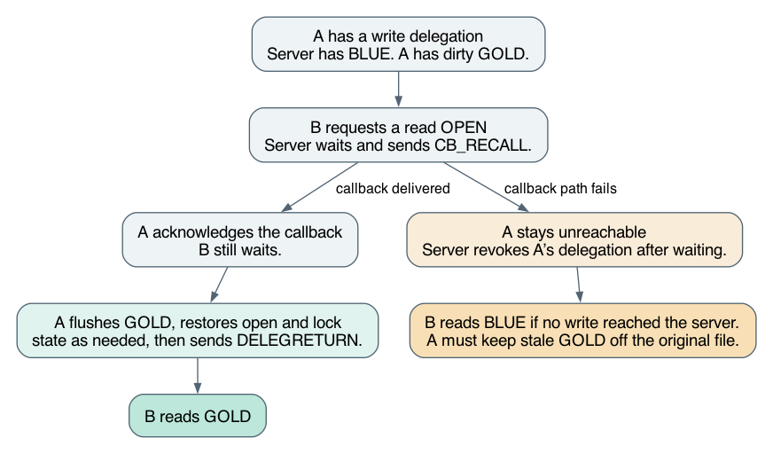

# What this lesson is trying to teach

NFSv4.1 delegation recall decides when a second client can use a cached file. A server must resolve a conflicting grant before it decides the new request.

## If you remember only these things

- A delegation belongs to an NFS client. Several processes on the same client can use it. A server may decline to grant one.
- Read delegations can coexist. A write open conflicts with read delegations. Another client's read open can conflict with a write delegation.
- An acknowledgment of CB_RECALL confirms delivery. The competing open waits for return or revocation, then the server checks ordinary access and share rules.
- After revocation, writing private dirty bytes back to the original file can overwrite another client's changes.

## A reader opens a file held by a writer

The server stores BLUE in a file called palette. A has a write delegation and has changed its cached copy to GOLD. The changed bytes are dirty until A writes them to the server. Closing a file can leave the delegation and dirty data in A's cache. An application that needs durable storage must still request synchronization. B now opens palette for reading with permission and no share-deny restriction. [NFSv4.1 open delegation](https://www.rfc-editor.org/rfc/rfc8881.html#section-10.4.1)



The server sends CB_RECALL over its backchannel, the connection for server-initiated requests. A acknowledges. B still waits. A flushes GOLD and reports outstanding opens and byte-range locks as applicable. If A had truncated the file locally, it propagates the pending truncation before the affected writes. A sends DELEGRETURN. The server can now grant B's open, and B reads GOLD. It can hold the original request or return NFS4ERR_DELAY while A works. [Recall procedure](https://www.rfc-editor.org/rfc/rfc8881.html#section-10.4.4)

If A stays unreachable, the server can revoke the grant after waiting. It may allow more time for a holder making progress. If A never flushed, B reads BLUE. If A's whole write reached the server before revocation, B can see GOLD. Revocation does not roll back accepted writes. A lease renewal on the forward connection can succeed during a backchannel failure. SEQUENCE status flags and TEST_STATEID help a returning client identify lost state. A stateid identifies the relevant grant or other protocol state. [Delegation recovery](https://www.rfc-editor.org/rfc/rfc8881.html#section-10.2.1)

A must surface the loss of dirty data. A recovered copy under a different name can help a user reconcile changes. Writing the old buffer to the original file could destroy B's later edit. Server restart and reclaim during a grace period follow a separate recovery path. [Dirty data after revocation](https://www.rfc-editor.org/rfc/rfc8881.html#section-10.5.1)

## Choosing a policy

| Access pattern | Benefit and cost |
|---|---|
| A single client repeatedly opens the same file | A grant can serve compatible opens locally. The next competing opener may pay the recall cost. |
| Several readers, rare writers | Read delegations can coexist. A writer must wait for every conflicting grant to clear. |
| Ownership changes frequently | Server-mediated opens pay a request per modeled open but avoid a delegation recall on handoff. |
| A single writer with substantial dirty data | Deferring writeback saves work across closes. Writeback, state transfer, retries and an unreachable holder can increase a competing reader's tail latency. |

For a slow open, measure the time from B's request to admission. Break it down by callback delivery, holder writeback, return or revocation, and B's retry. Count the holder's saved requests separately. [RFC 8881 §10.2](https://www.rfc-editor.org/rfc/rfc8881.html#section-10.2) · [Linux client delegation implementation](https://codebrowser.dev/linux/linux/fs/nfs/delegation.c.html#nfs4_inode_return_delegation)

## Run it

From this topic directory, run:

```sh
python3 recall.py
cargo test --locked -p topic115-nfs-delegation
cargo build --locked -p topic115-nfs-delegation
python3 oracle.py ../../target/debug/topic115-nfs-delegation
python3 cost.py > cost.csv
python3 test_cost.py
```

The Python example prints `return: B reads GOLD at 7 model ms` and `revoke: B reads BLUE at 31 model ms`. These times are chosen inputs. The Rust model tests acknowledgment, flush, cooperative return, revocation and retry as separate events. The Python oracle derives the expected result from event positions. Both use one whole-file update, compatible share modes, a single holder and no server restart.

The cost harness starts after A's file has closed and any grant is already installed. It times zero or eight compatible reopen/close pairs on A followed by one conflicting open on B. Two policies use the same serial socket request service with a 500 µs sleep per message. Delegated A handles its reopens locally and makes two extra exchanges on recall. The service holds B's OPEN while the grant is installed and answers it after the delegation return. `test_cost.py` checks that message order. The output gives total time and B's open time in microseconds. B's open time runs from B's request to B's reply. The program uses a local socket protocol. Real NFS can combine operations and pipeline writeback. See [results](RESULTS.md) for measured distributions and limits.
