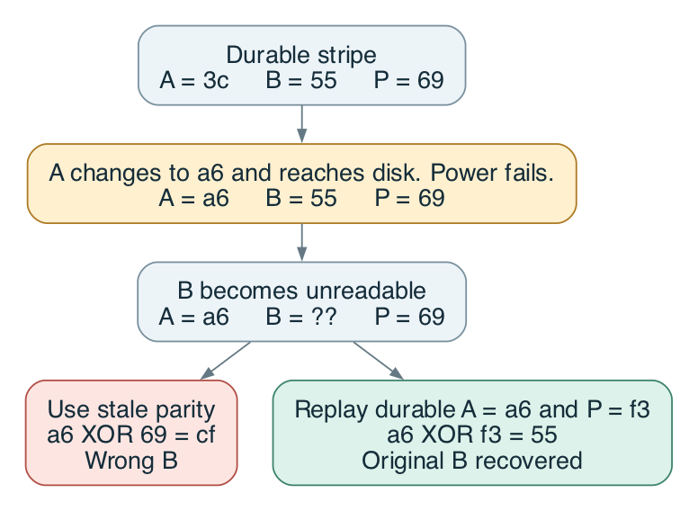

# What this lesson is trying to teach

A crash during a RAID 5 write can change the bytes later reconstructed for a block that nobody updated. Topic 116 follows one stripe through a crash and a degraded rebuild.

## If you remember only these things

- Reconstruction needs parity and surviving chunks that describe the same stripe contents.
- Full-stripe writes remove old-data reads. The member writes can still reach durable storage independently.
- A redo record must survive before the first home write and remain available through the last durable home write. Interrupted replay must be safe to repeat.
- A dirty bitmap identifies regions for resync. Reconstruction also needs authoritative contents.

## Follow one update

A stripe groups chunks on different disks. RAID 5 rotates the parity position across stripes. Here two members hold data and the third holds their bitwise exclusive OR, or XOR. At each bit, XOR yields one when its inputs differ. Applying the same operand twice cancels it. Thus `P = A ^ B` and `B = A ^ P`.

Start with hexadecimal `A=3c`, `B=55`, `P=69`. An overwrite changes A to `a6`. Read-modify-write uses old A and old P to compute `69 ^ 3c ^ a6 = f3`. Suppose new A is durable when power fails and P still holds `69`. B still reads `55` while available. Lose B before resync, and reconstruction gives `a6 ^ 69 = cf`. Recomputing parity from the rebuilt data now passes because `a6 ^ cf = 69`. Only an independent record of B exposes the corruption. Linux MD normally refuses to start a dirty, degraded RAID 5 or RAID 6 array. [Linux MD assembly rules](https://docs.kernel.org/admin-guide/md.html#boot-time-assembly-of-degraded-dirty-arrays)



## Choose a write policy and a recovery policy

| Policy | When it fits | Cost or failure boundary |
|---|---|---|
| Partial-stripe read-modify-write | One new chunk arrives. Read old A and P, then write new A and P. | Two reads and two writes in this example. Either write can reach storage first. |
| Full-stripe write in place | The caller already has both new data chunks. Compute P directly. | Zero old-data reads and three writes here. Waiting for a complete stripe can delay a small request. |
| Write-through redo journal | A record identifies the stripe and holds enough new bytes to replay. Make it durable, install the member writes, then retire the record after installation is durable. | Adds journal traffic and a durability dependency. MD completes the request after member writes are safe. |
| Write-back journal | A durable log can absorb small writes and aggregate them into full stripes. | Acknowledgment can precede member installation. Loss of the journal while it holds the only durable copy can lose acknowledged data. |
| RAID 5 partial parity log (PPL) | Store the XOR of untouched chunks before writing members. Here that XOR is B, `55`. Combine it with the A that survived to repair parity. | Lives on array members. Protects untouched data during degraded recovery. Loss of a modified member can lose in-flight data. |
| Bitmap-assisted resync | A dirty-region marker narrows what to scan when all data chunks are readable. | A marker alone supplies no missing B value. A parity check alone cannot identify the intended generation. |

For complete stripes, use all the supplied data to avoid old reads. For scattered updates, count reads, member writes, journal traffic and batching delay under the intended acknowledgment policy. Data/parity consistency and application commit atomicity require distinct guarantees. Linux MD's journal includes checksums and sequence information for recovery. [RAID journal and acknowledgment modes](https://docs.kernel.org/driver-api/md/raid5-cache.html) · [PPL recovery and its limits](https://docs.kernel.org/driver-api/md/raid5-ppl.html) · [MD consistency policies](https://docs.kernel.org/admin-guide/md.html)

## Run the example

From this topic directory, run:

```sh
python3 demo.py
cargo test -p topic116-raid-parity-write-hole
cargo build -p topic116-raid-parity-write-hole
python3 oracle.py ../../target/debug/topic116-raid-parity-write-hole
python3 file_crash.py
```

The same Python demonstration fits in a shell:

```sh
python3 - <<'PY'
old_a, b, new_a = 0x3c, 0x55, 0xa6
old_p = old_a ^ b
journal = (new_a, old_p ^ old_a ^ new_a)
a, p = new_a, old_p
print(f"stale rebuild: {a ^ p:02x}")
a, p = journal
print(f"after replay:  {a ^ p:02x}")
assert a ^ p == b
PY
```

Expect `cf` and then `55`. The Rust model issues one update on a healthy stripe. The oracle keeps the writer's bytes, computes parity independently one bit at a time and checks before log publication, with an unprotected crash, after interrupted replay, and after log retirement. It enumerates every subset of the planned member writes for both the writer and the first replay, and removes each possible member before recovery.

The file test puts each member in a separate temporary file, persists a redo record, and exits the writer and first replayer in child processes. It checks recovery against literal byte strings. Both experiments assume one writer, one missing member, a surviving valid log, and whole atomic member values. A real array also needs record validation, ordering across updates, handling for torn media writes and a tested device flush contract. See [observed results](RESULTS.md).
