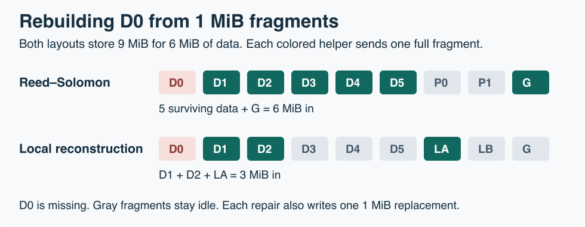

# Erasure-code repair amplification

These two systematic codes store six data fragments and three parity fragments. The data values are evaluations at points 0 through 5 in GF(256), with reduction polynomial 0x11d. RS uses the three additional evaluation points 7, 8 and 6. LRC replaces the first two parity rows with XORs over data positions 0–2 and 3–5. Both codes keep the same final global row. This small LRC is a teaching configuration.



A missing D0 costs six full reads for RS and three for LRC. Rebuilding the common global parity costs six for both. A separate rebuild host receives one fragment payload per read and writes one replacement. The LRC can lose D0, D3 and G together. Losing D0, D1 and LA leaves one equation for two unknowns. RS recovers from all three-erasure patterns. All inputs must be verified fragments of the same stripe generation.

From the workspace root:

```sh
cargo test -p topic117-erasure-repair
cargo build --release -p topic117-erasure-repair
python3 topics/117-erasure-repair/demo.py
python3 topics/117-erasure-repair/oracle.py target/release/topic117-erasure-repair
python3 topics/117-erasure-repair/measure.py target/release/topic117-erasure-repair > samples.csv
```

The demo returns byte 19 through each path. The oracle compares Newton interpolation and binary rank with the implementation's Lagrange encoding rows and field elimination. It checks every erasure mask, each missing target and every byte returned by the decoder. For three erasures, 84 of 84 patterns recover the entire RS stripe and 64 recover the LRC stripe.

The benchmark times only resident byte reconstruction. Each process builds one 1 MiB-per-fragment stripe, plans the repair, warms once, and measures eight reconstructions into a reusable destination. It verifies output before and after timing. The driver runs 20 fresh pairs per target and balances arm order. Input and output byte counts describe the decoder interface. Disk, network, checksums and scheduling across helpers require separate measurements.

## Sources

- Huang et al. derive the relationship between locality, storage overhead and recoverable failure patterns. [Erasure Coding in Windows Azure Storage, §§2–3](https://www.usenix.org/system/files/conference/atc12/atc12-final181_0.pdf)
- The systematic generator construction explains the any-k guarantee. [RFC 5510, §8](https://www.rfc-editor.org/rfc/rfc5510.html#section-8)
- Placement changes which repair reads cross a rack boundary. [Ceph LRC plugin](https://docs.ceph.com/en/latest/rados/operations/erasure-code-lrc/)
