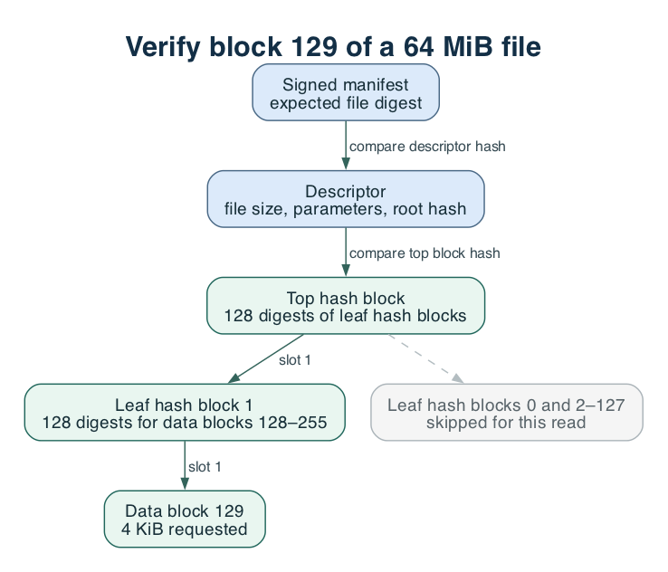

# What this lesson is trying to teach

A search service opens a 64 MiB index to read one 4 KiB block. Linux fs-verity lets it authenticate the requested bytes against an independently trusted file digest. The publisher reads the file once to build the tree. Readers can then verify individual blocks as they need them.

## If you remember only these things

- A Merkle tree packs digests into hash blocks and hashes those blocks again. The root commits to every block below it.
- A 4 KiB hash block holds 128 SHA-256 digests. Nearby reads can reuse verified hash blocks.
- Authenticate the fs-verity file digest. It binds file length and hashing parameters to the root. The same raw root can describe files with different lengths.
- A successful partial read establishes integrity for the bytes read. A policy that requires finding damage anywhere before activation needs a complete scan.

## Follow one read



The index contains 16,384 data blocks. The lowest tree level needs 128 hash blocks. One top block holds their digests. That is 129 × 4 KiB = 516 KiB, or 0.787% of file size, before descriptor and filesystem overhead. A partial final data or hash block is zero-padded for hashing. A nonempty file of at most one block has no hash blocks. Its raw root is the padded data block's hash. An empty file has an all-zero raw root.

Block 129 belongs to leaf hash block 1, slot 1. Given an authenticated descriptor, hash the top block and match it to the descriptor root. Slot 1 gives the expected hash of leaf block 1. Slot 1 of that verified leaf gives the expected hash of data block 129. Verify the requested bytes before returning them. Metadata exported by Linux through FS_IOC_READ_VERITY_METADATA lists levels top first. The example keeps separate arrays indexed from the leaf level.

| Request | Data blocks read | New hash blocks | Logical bytes |
|---|---:|---:|---:|
| 129, empty proof cache | 1 | 2 | 12 KiB |
| 130, same leaf | 1 | 0 | 4 KiB |
| 384, different leaf | 1 | 1 | 8 KiB |

The table assumes each data access misses and verified hash blocks stay resident. The three reads total 24 KiB for 12 KiB of requested data. A resident verified data page can be served from the page cache. Eviction can add work. Readahead, filesystem metadata and request merging affect physical device I/O. [Kernel verification path](https://github.com/torvalds/linux/blob/master/fs/verity/verify.c)

## Establish file identity

The publisher signs a manifest binding the index name and allowed release to its fs-verity file digest. Configure the publisher key independently. The service verifies the manifest, checks release policy, opens the index, measures its fs-verity digest and compares it with the expected value. Read from that same descriptor. Reopening a mutable pathname selects a file again. Enforcing a minimum release or pinned version also handles older, correctly signed indexes.

Enabling fs-verity requires a read-only descriptor and no writable opens. The filesystem builds a tree and makes the file contents immutable. Measuring the digest then takes constant time in file size. On page-in, a mismatch causes an I/O error for the affected read or SIGBUS on a mapped access. Discard the failed result and recover from a known-good copy. A signature can bind a digest to a publisher. The kernel's read checks alone establish consistency with the enabled file's digest. [Linux userspace API and access semantics](https://docs.kernel.org/filesystems/fsverity.html#user-api)

## Choose the verification method

| Method | Use it when | Cost and failure boundary |
|---|---|---|
| fs-verity with an authenticated file digest | A service sparsely reads immutable files deployed independently on a writable filesystem | One tree build and extra storage. Read-time verification checks accessed pages. Damage elsewhere can surface later. |
| Whole-file SHA-256 against a trusted digest | Acceptance requires inspecting every byte before first use | One sequential pass. Keep the verified snapshot stable between verification and use. Later storage faults need another check. |
| dm-verity with a trusted root | Deployment replaces a read-only block-device image | Block-device coverage. Updating a file changes the image. |

[fs-verity use cases](https://docs.kernel.org/filesystems/fsverity.html#use-cases) · [dm-verity](https://docs.kernel.org/admin-guide/device-mapper/verity.html)

## Run the example

From this directory, use Python 3.9 or later and the repository Rust toolchain.

```sh
python3 verity.py
python3 -m unittest -v test_verity
cargo test -p topic118-fs-verity
python3 measure.py > samples.csv
```

Expect 12, 4 and 8 KiB, followed by equal raw roots and different file digests for a one-byte file and its zero-extended form. The example uses immutable Python bytes, unsigned digests supplied by its caller, unsalted SHA-256 and 4 KiB blocks. The tests compare descriptor digests with five independent upstream answers and exercise corruption inside and outside the requested proof. Measurements compare eager and on-demand verification of the same stable bytes. See the [results](RESULTS.md). [Upstream test vectors](https://github.com/ebiggers/fsverity-utils/blob/36660d79c9ddbc4d560d9a496b6b67c1c25dcd13/programs/test_compute_digest.c) · [Linux descriptor format](https://docs.kernel.org/filesystems/fsverity.html#fs-verity-descriptor)

To probe the real Linux API, create a disposable file on the filesystem under test. The command closes the writer before enabling verity.

```sh
cc -std=gnu11 -Wall -Wextra -Werror kernel-probe.c -o /tmp/topic118-probe
probe_dir=$(mktemp -d ./topic118-probe.XXXXXX)
printf '\000' > "$probe_dir/one-zero"
/tmp/topic118-probe "$probe_dir/one-zero"
```

A supported filesystem prints the one-byte digest starting with `b8034295` and verifies a read. Exit 77 with an errno identifies an unsupported filesystem or feature. [fs-verity enable errors](https://docs.kernel.org/filesystems/fsverity.html#fs-ioc-enable-verity)
