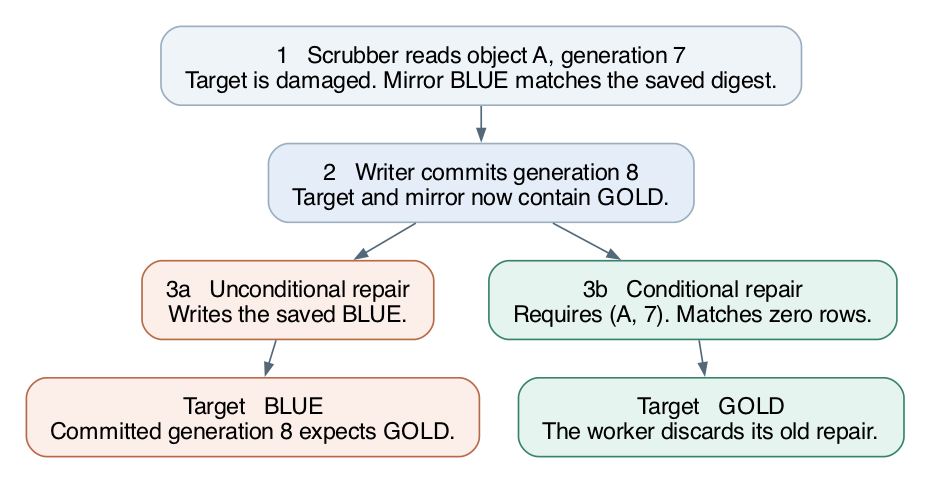

# Online scrub-and-repair races

A scrubber that found the right bytes can still damage the current block. Install a repair only while the object lifetime and logical generation observed during inspection remain current.

## If you remember only these things

- A trusted digest identifies the expected bytes of a particular version. Capture the key, object lifetime, generation, and expected digest in one coherent observation.
- Retain the exact donor bytes that passed verification. A mutable mirror can change after its first read.
- Compare the version and install the repair in one atomic write. Discard a stale plan and inspect the current block again.
- Give a recreated object a new lifetime identifier, even if its generation counter restarts.

## One block, two writers

A **scrub** reads stored data and checks its integrity. A **repair** replaces a damaged copy. The example stores one block at key 1. Its **incarnation** identifies one lifetime at that key. Its **generation** changes on every logical write, including writes of identical bytes. Repairing a physical copy preserves the logical generation.

At generation 7, the trusted SHA-256 digest describes `BLUE`. The target contains `FAIL`. The mirror contains `BLUE` and matches the digest. The scrubber saves the verified mirror bytes. While the worker is paused, the client commits `GOLD` at generation 8. Its write changes the trusted digest and both copies atomically. An unconditional repair then restores `BLUE` on the target. The stored generation still says 8.



The safe write has two possible orders. If repair commits first, it fixes generation 7 and the client then publishes generation 8. If the client commits first, the repair matches zero rows. In both orders the client leaves generation 8 intact. A separate version read immediately before an unconditional write still leaves room for the client to commit between the two statements.

```sql
UPDATE block SET target = :verified_bytes
WHERE id = :key AND incarnation = :lifetime AND gen = :observed_gen;
```

SQLite serializes writers. A single conditional statement can therefore protect both this comparison and the target update. The chosen condition covers the logical object because each foreground writer commits its bytes, version and digest together. If the payload is written to a raw device in a later operation, the SQL transaction only protects the row. Use a lock through completion of that I/O, or write a new immutable extent and conditionally publish its pointer after it is durable. [SQLite isolation](https://www.sqlite.org/isolation.html) · [SQLite UPDATE](https://www.sqlite.org/lang_update.html)

## Choosing a strategy

| Strategy | Use when | Cost or failure mode |
|---|---|---|
| Lock the object or range across inspection and installation | Every writer to the range honors the lock, and the protected read is short | Foreground writers wait for the repair I/O. XFS describes scoped locking for online metadata repair. [XFS online fsck design](https://docs.kernel.org/filesystems/xfs/xfs-online-fsck-design.html) |
| Verify outside the write transaction, then conditionally install | Storage can atomically check a non-reused version and replace the physical copy | A conflict discards verification work. Bound retries on hot objects and schedule a fresh inspection. |
| Write an immutable replacement and switch the live pointer conditionally | A repair spans storage layers or is too large for one atomic replacement | The replacement uses extra space. Flush it before publication and safely reclaim unreferenced copies after conflicts. |

When the key is deleted, the conditional update finds no target. Recreating the key at generation 7 still invalidates the old repair because the new block has a different incarnation. A real allocator must prevent token reuse across restarts, wraparound and restore. Include the mapping epoch or extent identity if a remap can redirect the physical write independently of the logical generation.

Two disagreeing copies identify a discrepancy. Repair also needs an authority for the right bytes and version. Here the committed metadata supplies it. If the digest is missing, both copies are bad, or the metadata itself may be damaged, preserve the evidence and use a separate recovery authority. Ceph documents the risk of selecting the wrong copy when only disagreement is visible. [Ceph placement-group repair](https://docs.ceph.com/en/latest/rados/troubleshooting/troubleshooting-pg/#how-pg-repair-works)

## Run the examples

From this topic directory with Python 3.9 or later and the repository Rust toolchain:

```sh
python3 scrub_demo.py
python3 -m unittest -v test_scrub
cargo test --locked -p topic119-online-scrub-repair
```

```text
unconditional 1 8 BLUE False
conditional 0 8 GOLD True
```

The columns give rows updated, final generation, final target and agreement with the final digest. The first row demonstrates the lost write. The second preserves the client's value.

The independent oracle consumes only scheduled logical writes and physical faults. It records the index of the last logical mutation. It predicts the target bytes and repair row count after each event without using database versions, SQL or digests. The Rust model uses exclusive access to a slot and an owned copy of verified bytes. A two-thread test pauses the scrubber after inspection and resumes it after a replacement or deletion.
