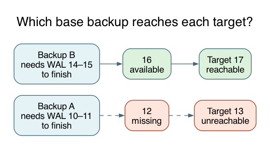

# Point-in-time recovery continuity

A target is reachable if a usable physical base and a continuous sequence of valid WAL records reach it on the selected timeline. A live backup copies pages at different times. Its manifest gives the start of replay and the earliest position at which replay can finish. A target before that boundary needs an older base.



Backup A needs segments 10 and 11 to become consistent. Base B needs 14 and 15. An order commits in 13 and a subsequent transaction deletes it in 14. With 12 missing, A can reach 11 and B can reach 15 through 17. Neither can restore the order at 13. Dropping 14 now breaks B's path to 17 as well.

## Run the example

From this directory:

```sh
python3 demo.py
cargo test -p topic120-pitr-continuity
```

Expected output:

```text
11 ['A']
13 []
15 ['B']
17 ['B']
after dropping 14: []
```

Each target here is a valid point at the end of a whole segment. The model assumes valid base files, readable WAL, one database and one timeline. PostgreSQL uses byte positions called LSNs. A segment can contain many commit records or part of a record. Recovery follows timeline history across branches. Equal LSNs on sibling timelines can refer to different transactions.

## Rehearse the missing segment

Put a matching PostgreSQL 16 server and client installation on PATH. Run as a regular user with enough temporary storage and permission to create PostgreSQL shared memory. The script creates its own clusters, Unix socket directory and archive.

```sh
python3 rehearse.py
```

The script streams WAL into each base with pg_basebackup, verifies both bases with pg_verifybackup, and archives subsequent WAL. It restores A to a named point after inserting order 42 and before deleting it. The query must return exactly orders 41 and 42. It then removes one post-backup segment from the test archive. Repeating the restore must fail before the named point. From B, the later restore must return exactly 41 and 43. Order 99 commits after this target and must be absent. The native drill uses actual segment names and transaction boundaries.

## Decide what to keep

Define the oldest promised target, the latest archived recovery point, the cluster identity and the timelines the promise covers. Include WAL embedded in base backups when computing each available replay path. Verify coverage throughout the window after a proposed deletion. A later independent base can begin a second recoverable interval after a gap. Testing only the newest point hides the gap.

Frequent full bases use more copy bandwidth and storage and can shorten replay. A longer WAL archive supports more historical targets while a compatible older base survives. A single standby's cleanup horizon suits private staging. Shared retention must account for every protected consumer and target. A backup file check covers the base and its required consistency WAL. Rehearse the target separately and verify both the last included operation and the first excluded operation.

## Sources

- [PostgreSQL continuous archiving, replay and timeline history](https://www.postgresql.org/docs/current/continuous-archiving.html)
- [Backup manifest WAL ranges](https://www.postgresql.org/docs/18/backup-manifest-wal-ranges.html)
- [Recovery target semantics](https://www.postgresql.org/docs/18/runtime-config-wal.html#RUNTIME-CONFIG-WAL-RECOVERY-TARGET)
- [pg_verifybackup coverage](https://www.postgresql.org/docs/current/app-pgverifybackup.html)
- [pg_archivecleanup scope](https://www.postgresql.org/docs/18/pgarchivecleanup.html)
