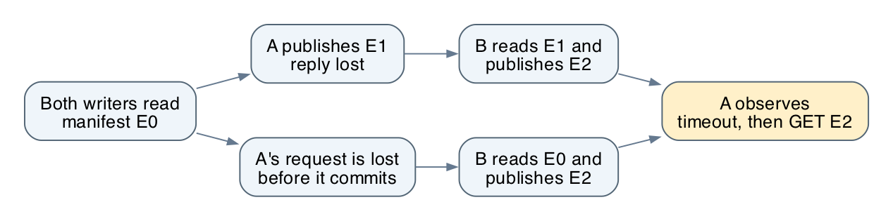

# What this lesson is trying to teach

Two release controllers publish to `manifest.json`. A conditional write protects the current release from a stale replacement. A lost reply raises a second question. The current release alone may give you too little information to decide whether a specific earlier write committed.

## If you remember only these things

- Create a key with `If-None-Match: *`. S3 evaluates absence when it writes. In a versioned bucket, a current delete marker counts as absence.
- For a read-modify-write, read the body and ETag together. Pass that ETag to `If-Match` when publishing the replacement.
- A failed precondition describes one physical attempt. An earlier attempt by the same caller may already have succeeded.
- To resolve retries after later publications, retain the operation ID, payload identity and result atomically with the state change for the full retry period.

## Protect the update

A and B read release 10 with ETag E0. An ETag is an opaque validator for the selected representation. A publishes 11 against E0. Once S3 installs a different ETag, B's attempt to publish 12 against E0 gets 412. B reads the new body and decides whether the transition from 11 to 12 is still valid. Reusing the old replacement with the new ETag can lose A's change.

With an unconditional PUT, B can replace A's release. A separate HEAD followed by an unconditional PUT still leaves a window for another writer. S3 checks a conditional PUT at publication. All writers that depend on this guarantee must follow the protocol. Bucket policy can require a conditional header.

The AWS CLI form below uses a configured general-purpose test bucket in `BUCKET`. Run it with a fresh prefix and permission to read and write it. The first command creates release 10. The GET returns its body and validator in one request. The last command attempts a stale replacement after release 11 is installed.

```bash
key="lesson-121/$(uuidgen)/manifest.json"
printf '%s\n' '{"release":10}' > release10.json
printf '%s\n' '{"release":11}' > release11.json
printf '%s\n' '{"release":12}' > release12.json
aws s3api put-object --bucket "$BUCKET" --key "$key" --body release10.json --if-none-match '*'
etag=$(aws s3api get-object --bucket "$BUCKET" --key "$key" --query ETag --output text read.json)
aws s3api put-object --bucket "$BUCKET" --key "$key" --body release11.json --if-match "$etag"
aws s3api put-object --bucket "$BUCKET" --key "$key" --body release12.json --if-match "$etag"
```

Expect the last PUT to fail with PreconditionFailed. A GET should return release 11 if these are the only writers. Retain the ETag as returned, including its quotes. This sequence publishes fixed bodies. A real controller derives its candidate from the body it read.

## Lose the reply



A sees a timeout. In the upper history S3 accepted release 11. In the lower history the request never arrived. B reads the current release and is allowed to advance either 10 or 11 to 12. It uses the observed tag for its conditional write. It publishes identical final bytes in the two histories. Assume those bytes have the same ETag in both.

A strongly consistent GET now returns 12 in either history. Retrying the original PUT against E0 can return 412 in both. A can conclude that the retry failed. Whether the original write succeeded is still unknown. A single last-operation ID can confirm a matching operation while its record remains current. B can replace that evidence.

## Choose the protocol

| Requirement | Publication rule | Cost or failure boundary |
|---|---|---|
| Immutable release artifact | Create under a stable name with If-None-Match. After an ambiguous result, verify the stored identity and payload. | Deletion reopens the name. Retention or a durable registry is required for permanent uniqueness. |
| Update a mutable release pointer | Compare the observed ETag on PUT. After conflict, read again and recompute if still allowed. | Each conflict can cost a read, a recomputation and another upload. An ETag can recur after identical bytes are restored. Include a fresh revision in each new body when intervening publications matter. |
| Answer historical retries | Keep receipts in the same conditionally replaced object and carry them forward, or commit the authoritative pointer and receipts in one database transaction. Bind each ID to its payload and result. | Retaining receipts grows state. A separate receipt object introduces a crash window between the two writes. |

A 409 can report a concurrent conflict. For PutObject, resolve any earlier ambiguous attempt, then retry according to the operation's precondition and current intent. If-Match with no live current object can return 404. Recreating the manifest requires the application's authorization for that transition. For multipart uploads, put the condition on CompleteMultipartUpload. On a 409 there, start the upload again. Large uploads may waste substantial work when publishers contend.

## Run locally

From this topic directory in the workspace, with Python 3, SQLite from the standard library, and the repository Rust toolchain:

```bash
cargo test --locked -p topic121-conditional-writes
printf '%s\n' 'abxx' 'adby' 'axyx' | cargo run --locked --quiet -p topic121-conditional-writes
python3 oracle.py
python3 demo.py
```

Each line starts absent. The model uses tags 1 and 2. Events a and b create the corresponding representation. Event x replaces 1 with 2, y replaces 2 with 1, and d deletes. Each output pair gives the response status and resulting tag. Zero denotes absence.

```text
200/1 412/1 200/2 412/2
200/1 204/0 200/2 200/1
200/1 200/2 200/1 200/2
```

The third trace returns to tag 1. A request carrying that old validator can now succeed. Tag equality alone cannot establish uninterrupted ownership. The SQLite oracle checks 3,125 five-event histories and 15,625 observations, including failed writes and deletion. The lost-reply demo prints `False 12 0` and `True 12 0`. Only the test knows the first value. A sees the current release and zero rows changed by its retry.

The model tests serialized decisions for one key. It treats a current delete marker as absence and deliberately reuses representation tags. Concurrent service-side 409 arbitration, multipart transport, IAM and live S3 behavior are outside this experiment.

## Sources

- [S3 conditional writes and conflict handling](https://docs.aws.amazon.com/AmazonS3/latest/userguide/conditional-writes.html)
- [PutObject request and response contract](https://docs.aws.amazon.com/AmazonS3/latest/API/API_PutObject.html)
- [S3 data consistency model](https://docs.aws.amazon.com/AmazonS3/latest/userguide/Welcome.html#ConsistencyModel)
- [HTTP entity tags and validator comparisons](https://www.rfc-editor.org/rfc/rfc9110.html#section-8.8.3)
