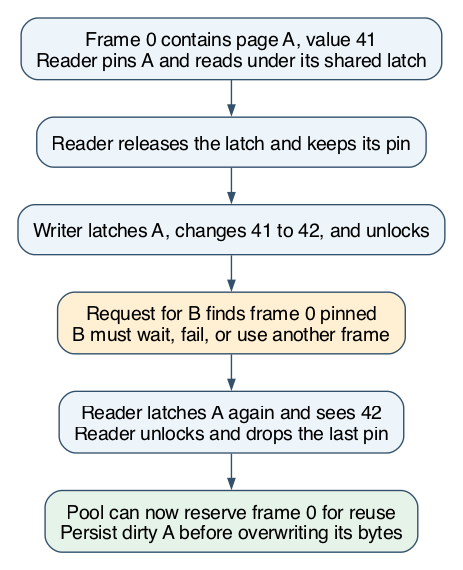

# What this lesson is trying to teach

Topic 122. A database buffer pool reuses RAM. A reader can keep a page resident while allowing a writer to change its bytes. The reader needs two guarantees with different lifetimes.

## If you remember only these things

- A page has a database identity. A frame is a reusable region of RAM. A pin keeps a frame assigned to its current page.
- A content latch coordinates access to the bytes. Readers can share a latch. A writer takes it exclusively in this example.
- Pin the page while its mapping is protected. Claim an eviction victim under protection against incoming pins.
- Release the latch before dropping the last pin. Give a miss an explicit outcome when every frame is pinned.

## One frame, two pages

Frame 0 holds account page A. A reader pins A, takes its shared latch, reads 41, and unlocks. A writer can now pin A and take its exclusive latch. It changes 41 to 42, unlocks, and drops its pin. The reader still owns a pin. A miss for B must wait, fail, or use another frame. When the reader latches A again, it sees 42. A stable page identity and an earlier value are different guarantees. Transaction isolation requires a separate database protocol.



If the reader unpins too early, another worker can load B into frame 0. A saved frame number still resolves to allocated memory. Taking frame 0's latch at that point lets the reader safely inspect the wrong account page. Looking up A and pinning it in separate steps creates the same race. Make lookup and pin acquisition one protected operation. Make the zero-pin check and reservation for reuse one protected operation as well. An atomic pin counter alone leaves both gaps open.

PostgreSQL pins a buffer before releasing its mapping lock. It also defines when a reader may keep a pointer into a page after unlocking. A heap scan can retain a pointer to a visible tuple. Cleanup that could move the tuple needs an exclusive content lock and a check that only the cleaning backend holds a pin. A general page format must define when interior references remain valid. [PostgreSQL shared-buffer access rules](https://github.com/postgres/postgres/blob/REL_17_STABLE/src/backend/storage/buffer/README)

## Choosing the access pattern

| Need | What to retain | Cost |
|---|---|---|
| One value after a pause | Copy the value under the latch and release both guards | Copying costs time and space. The copy records the earlier value. |
| Repeated accesses to the same resident page | Keep the pin and reacquire the latch for each access | The page occupies a frame between reads. |
| One consistent examination of mutable bytes | Keep the pin and shared latch through the examination | Writers wait. |
| A fresh read after a long pause | Keep the page ID and fetch it again | Lookup and possible I/O. Check for logical deletion or ID reuse if the database permits it. |

LRU-K and similar policies rank eligible frames. Pinned frames are ineligible even when cold. When all frames are pinned, inspect the pin owners and hold times. Waiting while holding the resources another worker needs to unpin can deadlock. An immediate busy result makes that failure visible in a small pool. Dirty victims also require a safe handoff of the old contents before overwrite. Production pools coordinate this with writeback, concurrent lookups, I/O failures, and database durability rules. [CMU buffer-pool specification](https://15445.courses.cs.cmu.edu/fall2024/project1/)

## Run the example

From the repository root, with Rust 1.93.1:

```sh
cargo run --locked -p topic122-buffer-pinning
cargo test --locked -p topic122-buffer-pinning
```

The standalone source archive has the same entry points. The demo prints:

```text
first read A 41
B request busy
second read A 42
B retry 90
A reloaded 42
```

The guard's destructor releases a pin. Each read copies a value under the shared latch. Each write takes the exclusive latch. The pool saves the outgoing value to an in-memory backing array on every replacement. A mutex protects the mapping, the pin count and the decision to reuse. The second worker runs on an OS thread. Joining it makes the update order repeatable.

The oracle keeps permanent logical pages and two client claims. It grants a request when the other client has no conflicting claim. It has no frames or reference counters. The test compares acquisition outcomes, reads and both final page values across all 100,000 length-five histories of ten client actions. Duplicate acquisitions by an occupied client and operations on an empty guard are defined as no-ops. This bounds the checked histories. Disk I/O, throughput, locking under production contention and transaction snapshots are outside the experiment.

## Run the stale-reference control

```sh
python3 - <<'PY'
frame = {"page": "A", "value": 41, "pins": 1}

def load_b():
    if frame["pins"]:
        return "busy"
    frame.update(page="B", value=90)
    return "loaded"

saved_frame = frame
print("first read", frame["value"])
frame["value"] = 42
print("B request", load_b())
print("second read", frame["page"], frame["value"])
frame["pins"] -= 1
print("B retry", load_b())
print("stale frame reference", saved_frame["page"], saved_frame["value"])
PY
```

The final line prints `stale frame reference B 90`. It models use of the physical frame after the reader gave up its right to A. This sequential control omits writeback and represents each access as one serialized step.
